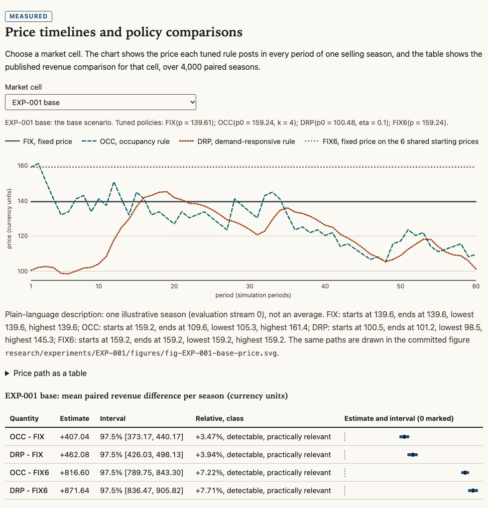

<!-- SPDX-License-Identifier: LicenseRef-FARE-NC-Research-1.0 -->
# FARE: pricing policies in a simulated booking market

**Status: M6 release candidate prepared on 2026-11-25 and public in this repository since 2026-11-25, awaiting the owner's review; no release, tag or DOI exists yet (M5, the interactive experience, is done). The frozen matrix ran in full (M3, 925,000 runs, 0 failed); experiment reports, an evidence audit, a preprint-draft manuscript (not peer-reviewed) and a static, offline demo exist. All results are simulated. The owner approved the manuscript title and the funding, competing-interest and AI-use statements on 2026-11-25; the owner's full-text review of the manuscript is pending (`research/publication/author_review.md`). Compiled PDFs of the manuscript, supplementary file and experiment reports sit next to their Markdown sources. The repository is public; nothing else has been published.**

**Question.** How do demand and inventory policies affect prices and availability in a simulated market?

**Why it matters.** Sellers of perishable capacity (seats, rooms) change prices as stock and time run out. Theory shows that a well-chosen fixed price can be close to optimal when sales volumes are large. FARE asks, in a transparent and reproducible simulation, what simple dynamic rules change for revenue, availability, price stability and buyers, and how fragile any difference is.



**Key findings (simulated; identical to the manuscript, `research/paper/manuscript.md`).**

- At the base cell (EXP-001), OCC and DRP earn +407.0 (97.5% interval [373.2, 440.2], +3.47%) and +462.1 ([426.0, 498.1], +3.94%) currency units per season more than the tuned fixed price, over 4,000 paired streams. Both null hypotheses are rejected.
- The sign is not general (EXP-002): all 18 contrasts reject the null after Holm adjustment, but 8 are negative, including every loose-capacity cell (DRP down to -11.41%).
- The preregistered invalidation rule of EXP-003 is not triggered, but against a fixed price re-tuned to the true demand the rules lose at 0.6 times the forecast demand (-7.47% and -8.52%), and their relevant gains are confined to demand above the forecast (and, for OCC, reversed arrivals).
- No general advantage of dynamic pricing is supported, even within the model. Limitations: `research/limitations.md`.

**What exists now.** Control files, a feasibility audit, a targeted literature and dataset review, a protocol frozen as v1.0 (`research/freeze.json`) and three registered, frozen experiments. Also implemented: the core package `src/fare/`, with a demand-stream generator, the fixed-price baseline, occupancy and demand-responsive rules, a simulator with invariant checks and a reference oracle, metrics, equal-budget tuning, paired statistics, a runner, a JSON result schema, run manifests, a freeze guard and a report generator, plus a number-trace audit tool. Also a static interactive demo in `demo/` (M5). The Python tests and the demo tests pass; the counts are recorded in `progress.md`.

| Experiment | Question | Status |
|---|---|---|
| EXP-001 | Tuned occupancy and demand-responsive rules versus the best fixed price, base scenario | confirmatory, complete; report `research/experiments/EXP-001/report.md` |
| EXP-002 | Sensitivity to price elasticity and demand-to-capacity tightness | confirmatory, complete; report `research/experiments/EXP-002/report.md` |
| EXP-003 | Robustness to demand misspecification (can invalidate EXP-001's interpretation) | confirmatory, complete; report `research/experiments/EXP-003/report.md` |

**Demo quick start.** The demo is a static page (TypeScript, React, Vite; pinned versions, lockfile). It loads `demo/public/data/results.json`, written by `scripts/export_demo_data.py` from committed results only, fails closed on a malformed file, runs offline after the first load and collects nothing.

```
cd demo && npm ci && npm run build && npm run preview
```

`npm test` runs the demo tests, including the check of the browser sandbox against the Python engine (fixture from `scripts/make_sandbox_fixture.py`). Demo: https://fare-dynamic-pricing.kefimohamedbechir.workers.dev (Cloudflare Workers static assets, free plan; see `demo/README.md`).

**Navigation.** `research/paper/manuscript.md` (preprint draft, not peer-reviewed), `research/publication/evidence_audit.md`, `research/protocol.md` (study protocol, frozen v1.0), `research/experiments/EXP-NNN/protocol.md`, `research/feasibility.md`, `research/literature_review.md`, `research/limitations.md`, `roadmap.md`, `progress.md`.

**Scope and exclusions.** Synthetic data only. No airline or hotel personalisation claims, no live scraping, no actual fare predictions, no claims about proprietary systems. Zero cost: no paid APIs, data, compute or hosting.

**Quick start (development).**

```
../.tools/py/bin/uv sync --frozen --python /usr/local/bin/python3
export PYTHONPATH=src
uv run --frozen python -m fare.cli test                     # test suite
uv run --frozen python -m fare.cli smoke                    # exploratory smoke run -> results/exploratory/
uv run --frozen python -m fare.cli run --plan --config research/experiments/EXP-001/config.json
uv run --frozen python -m fare.cli report --result results/exploratory/<run_set_id>/result.json
```

`run` accepts the frozen confirmatory configs in `research/experiments/EXP-NNN/config.json` only while they, the protocols and `research/freeze.json` agree; any changed config or protocol is refused.

**Licence.** FARE Source-Available Non-Commercial Research License v1.0 (`LicenseRef-FARE-NC-Research-1.0`); see `LICENSE` and `NOTICE.md`. Not an OSI open-source licence. Third-party material keeps its own terms.

**Citation.** See `CITATION.cff`. Author: Mohamed Bechir Kefi, independent researcher. Repository: https://github.com/mohamedbechirkefi/fare-dynamic-pricing. Funding: no funding was received. Competing interests: the author declares no competing interests.
