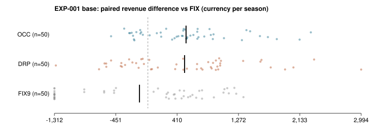
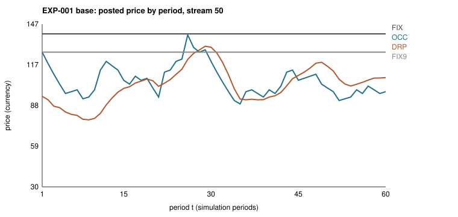

<!-- SPDX-License-Identifier: LicenseRef-FARE-NC-Research-1.0 -->
# EXP-001 run set EXP-001-exp-pilot-exp001-20261124T161050Z

**EXPLORATORY. Not evidence.** Produced before the owner froze the protocol; exploratory runs are never reported as findings.

All numbers are simulated and hold only within the model of `research/protocol.md`.

- Created (UTC): 2026-11-24T16:10:50Z
- Config SHA-256: `88e2caa9fb8995b79554e27f06042ef8388328a5832c0bfab9f85c630bf887cb`
- Protocol: `research/experiments/EXP-001/protocol.md` SHA-256 `0066a421e09217a7184f92a1de3e3c1f24dafd4c74b6b41e2706350fd283b984`, frozen: False
- Failed runs: 0
- Manifest: `run_manifest.json`

EXPLORATORY PILOT for EXP-001, run before the owner's freeze. Tuning streams only: policies are tuned on tuning streams 0-49 and evaluated on tuning streams 50-99; evaluation streams (role 1) are never generated. Purpose: runtime per run, projected full-matrix time, spread of paired differences between streams (seed-count adequacy) and degenerate cells or grid-edge optima. Not evidence and never reported as a finding.

## Cell base (index 0)

Timing: stream generation 0.06 s; tuning 5850 runs in 0.32 s; evaluation 200 runs in 0.04 s.

### Tuning

| Arm | Tuned in cell | Configs x streams | Selected | Mean tuning revenue | At grid edge | Purchase elasticity at selected FIX price |
|---|---|---|---|---|---|---|
| FIX | base | 36 x 50 | FIX(p=139.6) | 11,892.00 | no | -1.557 |
| OCC | base | 36 x 50 | OCC(p0=126.5, k=4) | 12,397.45 | yes | n/a |
| DRP | base | 36 x 50 | DRP(p0=94.85, eta=0.1, weight=0.3) | 12,501.49 | yes | n/a |
| FIX9 | base | 9 x 50 | FIX(p=126.5) | 11,573.94 | no | -1.400 |

### Arms (per-stream metrics)

| Arm | Policy | n | revenue mean (sd) | sell_through mean (sd) | availability mean (sd) | price_volatility mean (sd) | consumer_surplus mean (sd) | stockout_period mean (sd) |
|---|---|---|---|---|---|---|---|---|
| FIX | FIX(p=139.6) | 50 | 11,593.23 (2,351.05) | 0.83 (0.17) | 0.97 (0.05) | 0.00 (0.00) | 7,758.80 (1,683.32) | 58.24 (5.46) |
| OCC | OCC(p0=126.5, k=4) | 50 | 12,129.64 (2,329.07) | 0.96 (0.06) | 0.98 (0.02) | 0.04 (0.00) | 8,989.50 (963.92) | 59.20 (2.19) |
| DRP | DRP(p0=94.85, eta=0.1, weight=0.3) | 50 | 12,108.70 (2,490.55) | 0.98 (0.04) | 0.99 (0.02) | 0.03 (0.01) | 9,001.82 (936.43) | 59.28 (1.84) |
| FIX9 | FIX(p=126.5) | 50 | 11,475.27 (1,753.84) | 0.91 (0.14) | 0.94 (0.09) | 0.00 (0.00) | 8,063.60 (1,292.86) | 54.96 (7.92) |

### Paired contrasts

| Arm | vs | Metric | n | Mean paired diff | SD diff | d_z | Level | Bootstrap CI | t CI | Relative | Class |
|---|---|---|---|---|---|---|---|---|---|---|---|
| OCC | FIX | revenue | 50 | 536.412 | 654.826 | 0.819 | 0.975 | [332.817, 741.055] | [322.271, 750.553] | 4.63% | detectable_practically_relevant |
| DRP | FIX | revenue | 50 | 515.471 | 871.122 | 0.592 | 0.975 | [243.466, 793.621] | [230.597, 800.344] | 4.45% | detectable_practically_relevant |
| OCC | FIX9 | revenue | 50 | 654.369 | 1,084.635 | 0.603 | 0.975 | [335.156, 1,005.139] | [299.673, 1,009.066] | 5.70% | detectable_practically_relevant |
| DRP | FIX9 | revenue | 50 | 633.428 | 1,289.990 | 0.491 | 0.975 | [243.718, 1,047.975] | [211.577, 1,055.280] | 5.52% | detectable_practically_relevant |
| OCC | FIX | sell_through | 50 | 0.133 | 0.123 | 1.077 | 0.95 | [0.100, 0.168] | [0.098, 0.168] | 16.02% | n/a |
| OCC | FIX | availability | 50 | 0.011 | 0.039 | 0.277 | 0.95 | [0.001, 0.022] | [-0.000, 0.022] | 1.11% | n/a |
| OCC | FIX | consumer_surplus | 50 | 1,230.703 | 1,158.020 | 1.063 | 0.95 | [916.440, 1,558.377] | [901.598, 1,559.809] | 15.86% | n/a |
| OCC | FIX | total_surplus | 50 | 1,767.115 | 1,433.068 | 1.233 | 0.95 | [1,372.215, 2,166.606] | [1,359.842, 2,174.389] | 9.13% | n/a |
| DRP | FIX | sell_through | 50 | 0.152 | 0.150 | 1.014 | 0.95 | [0.112, 0.195] | [0.110, 0.195] | 18.35% | n/a |
| DRP | FIX | availability | 50 | 0.012 | 0.055 | 0.216 | 0.95 | [-0.002, 0.027] | [-0.004, 0.027] | 1.22% | n/a |
| DRP | FIX | consumer_surplus | 50 | 1,243.026 | 1,579.190 | 0.787 | 0.95 | [821.703, 1,697.479] | [794.226, 1,691.827] | 16.02% | n/a |
| DRP | FIX | total_surplus | 50 | 1,758.497 | 1,733.752 | 1.014 | 0.95 | [1,281.301, 2,245.650] | [1,265.770, 2,251.224] | 9.09% | n/a |

## Multiplicity across cells (revenue vs FIX, Holm over all listed contrasts)

| Cell | Arm | n | Mean paired revenue diff | Sign-flip p | Holm-adjusted p |
|---|---|---|---|---|---|
| base | OCC | 50 | 536.412 | 0.0001 | 0.0002 |
| base | DRP | 50 | 515.471 | 0.0002 | 0.0002 |
