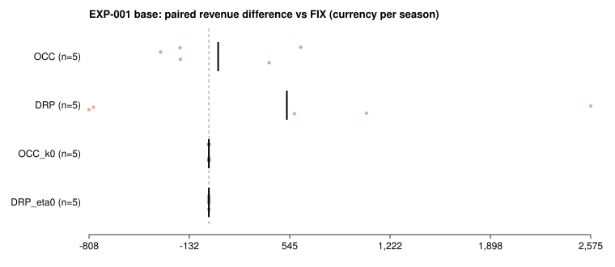
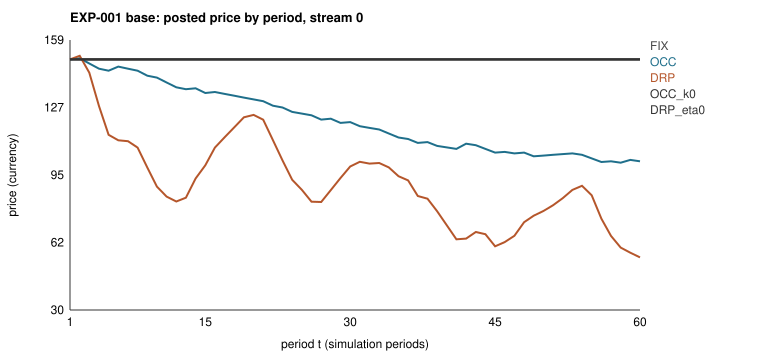
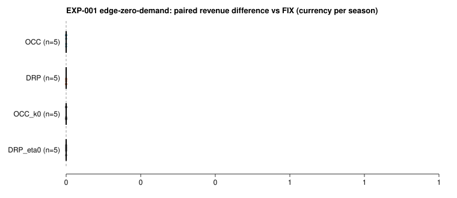
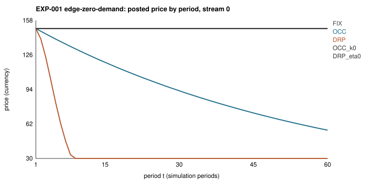
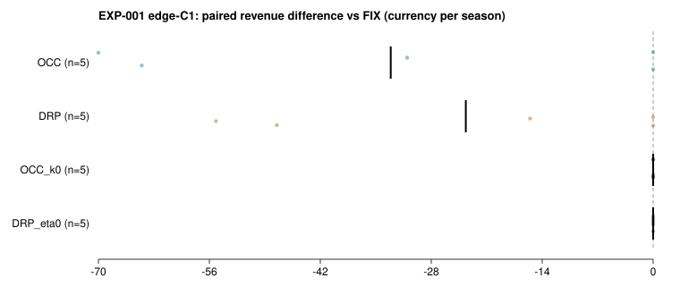
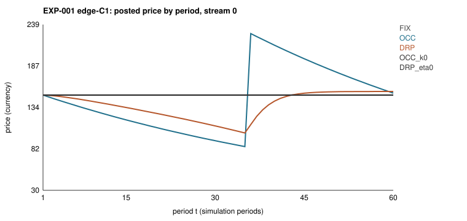
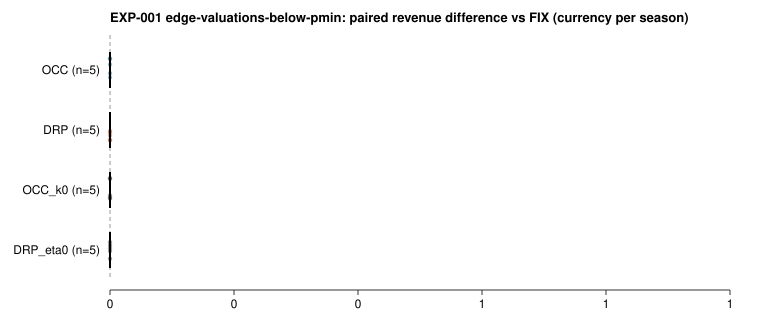
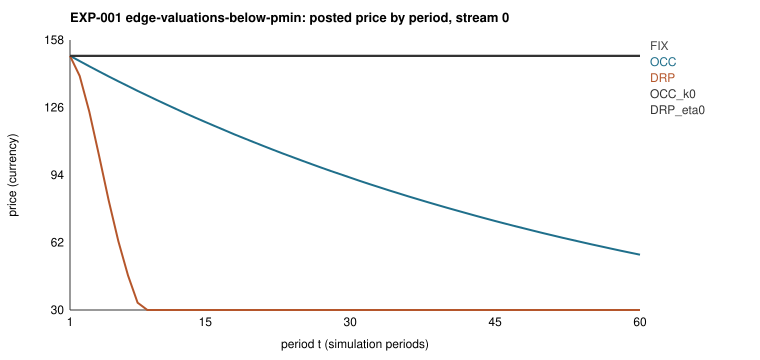
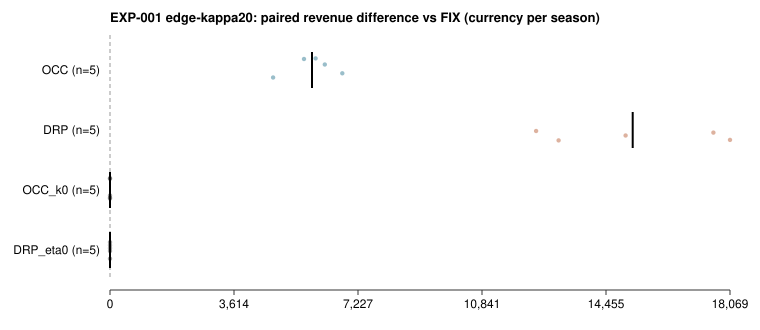
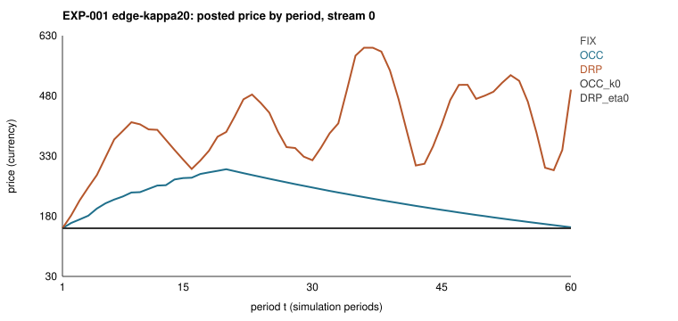

<!-- SPDX-License-Identifier: LicenseRef-FARE-NC-Research-1.0 -->
# EXP-001 run set EXP-001-exp-smoke-20261124T233439Z

**EXPLORATORY. Not evidence.** Produced before the owner froze the protocol; exploratory runs are never reported as findings.

All numbers are simulated and hold only within the model of `research/protocol.md`.

- Created (UTC): 2026-11-24T23:34:39Z
- Config SHA-256: `8a4fe5ea7b33fee7dcd29f1aef6e21e924f48f2129ecab26feb8398086372588`
- Protocol: `research/experiments/EXP-001/protocol.md` SHA-256 `06f939d8fd59389a3438cd539f862a36ed4d47275137b50aeb3ffdc233df2ec2`, frozen: False
- Failed runs: 0
- Manifest: `run_manifest.json`

Smoke matrix of research/protocol.md section 9 and EXP-001 protocol section 18: base cell with one hand-set configuration per family plus nesting arms (OCC k=0, DRP eta=0) on 5 tuning streams, and edge-case cells. Exploratory; validates invariants and metric code and measures runtime. Never evidence.

## Cell base (index 0)

Timing: stream generation 0.01 s; tuning 0 runs in 0.00 s; evaluation 25 runs in 0.00 s.

### Tuning

_No tuning in this cell (fixed hand-set policies)._

### Arms (per-stream metrics)

| Arm | Policy | n | revenue mean (sd) | sell_through mean (sd) | availability mean (sd) | price_volatility mean (sd) | consumer_surplus mean (sd) | stockout_period mean (sd) |
|---|---|---|---|---|---|---|---|---|
| FIX | FIX(p=150) | 5 | 10,560.00 (3,521.97) | 0.70 (0.23) | 0.97 (0.06) | 0.00 (0.00) | 6,166.11 (2,099.90) | 59.20 (4.02) |
| OCC | OCC(p0=150, k=1) | 5 | 10,622.80 (3,930.90) | 0.78 (0.20) | 0.98 (0.05) | 0.01 (0.00) | 7,207.46 (1,476.46) | 59.80 (2.68) |
| DRP | DRP(p0=150, eta=0.25, weight=0.3) | 5 | 11,085.85 (4,574.27) | 0.96 (0.08) | 0.99 (0.02) | 0.06 (0.01) | 8,597.44 (1,156.88) | 59.40 (1.52) |
| OCC_k0 | OCC(p0=150, k=0) | 5 | 10,560.00 (3,521.97) | 0.70 (0.23) | 0.97 (0.06) | 0.00 (0.00) | 6,166.11 (2,099.90) | 59.20 (4.02) |
| DRP_eta0 | DRP(p0=150, eta=0, weight=0.3) | 5 | 10,560.00 (3,521.97) | 0.70 (0.23) | 0.97 (0.06) | 0.00 (0.00) | 6,166.11 (2,099.90) | 59.20 (4.02) |

### Paired contrasts

| Arm | vs | Metric | n | Mean paired diff | SD diff | d_z | Level | Bootstrap CI | t CI | Relative | Class |
|---|---|---|---|---|---|---|---|---|---|---|---|
| OCC | FIX | revenue | 5 | 62.796 | 421.036 | 0.149 | 0.975 | [-272.517, 430.445] | [-595.365, 720.956] | 0.59% | inconclusive |
| DRP | FIX | revenue | 5 | 525.845 | 1,411.484 | 0.373 | 0.975 | [-777.700, 1,775.963] | [-1,680.577, 2,732.268] | 4.98% | inconclusive |
| OCC_k0 | FIX | revenue | 5 | 0.000 | 0.000 | n/a | 0.975 | [0.000, 0.000] | [0.000, 0.000] | 0.00% | practically_equivalent |
| DRP_eta0 | FIX | revenue | 5 | 0.000 | 0.000 | n/a | 0.975 | [0.000, 0.000] | [0.000, 0.000] | 0.00% | practically_equivalent |
| OCC | FIX | sell_through | 5 | 0.076 | 0.047 | 1.609 | 0.95 | [0.038, 0.110] | [0.017, 0.135] | 10.80% | n/a |
| OCC | FIX | availability | 5 | 0.005 | 0.010 | 0.447 | 0.95 | [0.000, 0.014] | [-0.008, 0.017] | 0.46% | n/a |
| OCC | FIX | consumer_surplus | 5 | 1,041.343 | 848.374 | 1.227 | 0.95 | [346.970, 1,645.454] | [-12.052, 2,094.738] | 16.89% | n/a |
| OCC | FIX | total_surplus | 5 | 1,104.139 | 510.247 | 2.164 | 0.95 | [685.363, 1,490.126] | [470.583, 1,737.694] | 6.60% | n/a |
| DRP | FIX | sell_through | 5 | 0.258 | 0.200 | 1.288 | 0.95 | [0.112, 0.404] | [0.009, 0.507] | 36.65% | n/a |
| DRP | FIX | availability | 5 | 0.013 | 0.040 | 0.311 | 0.95 | [-0.010, 0.049] | [-0.038, 0.063] | 1.29% | n/a |
| DRP | FIX | consumer_surplus | 5 | 2,431.322 | 2,918.522 | 0.833 | 0.95 | [30.210, 4,487.959] | [-1,192.501, 6,055.145] | 39.43% | n/a |
| DRP | FIX | total_surplus | 5 | 2,957.167 | 1,992.767 | 1.484 | 0.95 | [1,480.120, 4,447.235] | [482.820, 5,431.515] | 17.68% | n/a |
| OCC_k0 | FIX | sell_through | 5 | 0.000 | 0.000 | n/a | 0.95 | [0.000, 0.000] | [0.000, 0.000] | 0.00% | n/a |
| OCC_k0 | FIX | availability | 5 | 0.000 | 0.000 | n/a | 0.95 | [0.000, 0.000] | [0.000, 0.000] | 0.00% | n/a |
| OCC_k0 | FIX | consumer_surplus | 5 | 0.000 | 0.000 | n/a | 0.95 | [0.000, 0.000] | [0.000, 0.000] | 0.00% | n/a |
| OCC_k0 | FIX | total_surplus | 5 | 0.000 | 0.000 | n/a | 0.95 | [0.000, 0.000] | [0.000, 0.000] | 0.00% | n/a |
| DRP_eta0 | FIX | sell_through | 5 | 0.000 | 0.000 | n/a | 0.95 | [0.000, 0.000] | [0.000, 0.000] | 0.00% | n/a |
| DRP_eta0 | FIX | availability | 5 | 0.000 | 0.000 | n/a | 0.95 | [0.000, 0.000] | [0.000, 0.000] | 0.00% | n/a |
| DRP_eta0 | FIX | consumer_surplus | 5 | 0.000 | 0.000 | n/a | 0.95 | [0.000, 0.000] | [0.000, 0.000] | 0.00% | n/a |
| DRP_eta0 | FIX | total_surplus | 5 | 0.000 | 0.000 | n/a | 0.95 | [0.000, 0.000] | [0.000, 0.000] | 0.00% | n/a |

## Cell edge-zero-demand (index 90)

Timing: stream generation 0.00 s; tuning 0 runs in 0.00 s; evaluation 25 runs in 0.00 s.

### Tuning

_No tuning in this cell (fixed hand-set policies)._

### Arms (per-stream metrics)

| Arm | Policy | n | revenue mean (sd) | sell_through mean (sd) | availability mean (sd) | price_volatility mean (sd) | consumer_surplus mean (sd) | stockout_period mean (sd) |
|---|---|---|---|---|---|---|---|---|
| FIX | FIX(p=150) | 5 | 0.00 (0.00) | 0.00 (0.00) | 1.00 (0.00) | 0.00 (0.00) | 0.00 (0.00) | 61.00 (0.00) |
| OCC | OCC(p0=150, k=1) | 5 | 0.00 (0.00) | 0.00 (0.00) | 1.00 (0.00) | 0.02 (0.00) | 0.00 (0.00) | 61.00 (0.00) |
| DRP | DRP(p0=150, eta=0.25, weight=0.3) | 5 | 0.00 (0.00) | 0.00 (0.00) | 1.00 (0.00) | 0.03 (0.00) | 0.00 (0.00) | 61.00 (0.00) |
| OCC_k0 | OCC(p0=150, k=0) | 5 | 0.00 (0.00) | 0.00 (0.00) | 1.00 (0.00) | 0.00 (0.00) | 0.00 (0.00) | 61.00 (0.00) |
| DRP_eta0 | DRP(p0=150, eta=0, weight=0.3) | 5 | 0.00 (0.00) | 0.00 (0.00) | 1.00 (0.00) | 0.00 (0.00) | 0.00 (0.00) | 61.00 (0.00) |

### Paired contrasts

| Arm | vs | Metric | n | Mean paired diff | SD diff | d_z | Level | Bootstrap CI | t CI | Relative | Class |
|---|---|---|---|---|---|---|---|---|---|---|---|
| OCC | FIX | revenue | 5 | 0.000 | 0.000 | n/a | 0.975 | [0.000, 0.000] | [0.000, 0.000] | n/a | n/a |
| DRP | FIX | revenue | 5 | 0.000 | 0.000 | n/a | 0.975 | [0.000, 0.000] | [0.000, 0.000] | n/a | n/a |
| OCC_k0 | FIX | revenue | 5 | 0.000 | 0.000 | n/a | 0.975 | [0.000, 0.000] | [0.000, 0.000] | n/a | n/a |
| DRP_eta0 | FIX | revenue | 5 | 0.000 | 0.000 | n/a | 0.975 | [0.000, 0.000] | [0.000, 0.000] | n/a | n/a |
| OCC | FIX | sell_through | 5 | 0.000 | 0.000 | n/a | 0.95 | [0.000, 0.000] | [0.000, 0.000] | n/a | n/a |
| OCC | FIX | availability | 5 | 0.000 | 0.000 | n/a | 0.95 | [0.000, 0.000] | [0.000, 0.000] | 0.00% | n/a |
| OCC | FIX | consumer_surplus | 5 | 0.000 | 0.000 | n/a | 0.95 | [0.000, 0.000] | [0.000, 0.000] | n/a | n/a |
| OCC | FIX | total_surplus | 5 | 0.000 | 0.000 | n/a | 0.95 | [0.000, 0.000] | [0.000, 0.000] | n/a | n/a |
| DRP | FIX | sell_through | 5 | 0.000 | 0.000 | n/a | 0.95 | [0.000, 0.000] | [0.000, 0.000] | n/a | n/a |
| DRP | FIX | availability | 5 | 0.000 | 0.000 | n/a | 0.95 | [0.000, 0.000] | [0.000, 0.000] | 0.00% | n/a |
| DRP | FIX | consumer_surplus | 5 | 0.000 | 0.000 | n/a | 0.95 | [0.000, 0.000] | [0.000, 0.000] | n/a | n/a |
| DRP | FIX | total_surplus | 5 | 0.000 | 0.000 | n/a | 0.95 | [0.000, 0.000] | [0.000, 0.000] | n/a | n/a |
| OCC_k0 | FIX | sell_through | 5 | 0.000 | 0.000 | n/a | 0.95 | [0.000, 0.000] | [0.000, 0.000] | n/a | n/a |
| OCC_k0 | FIX | availability | 5 | 0.000 | 0.000 | n/a | 0.95 | [0.000, 0.000] | [0.000, 0.000] | 0.00% | n/a |
| OCC_k0 | FIX | consumer_surplus | 5 | 0.000 | 0.000 | n/a | 0.95 | [0.000, 0.000] | [0.000, 0.000] | n/a | n/a |
| OCC_k0 | FIX | total_surplus | 5 | 0.000 | 0.000 | n/a | 0.95 | [0.000, 0.000] | [0.000, 0.000] | n/a | n/a |
| DRP_eta0 | FIX | sell_through | 5 | 0.000 | 0.000 | n/a | 0.95 | [0.000, 0.000] | [0.000, 0.000] | n/a | n/a |
| DRP_eta0 | FIX | availability | 5 | 0.000 | 0.000 | n/a | 0.95 | [0.000, 0.000] | [0.000, 0.000] | 0.00% | n/a |
| DRP_eta0 | FIX | consumer_surplus | 5 | 0.000 | 0.000 | n/a | 0.95 | [0.000, 0.000] | [0.000, 0.000] | n/a | n/a |
| DRP_eta0 | FIX | total_surplus | 5 | 0.000 | 0.000 | n/a | 0.95 | [0.000, 0.000] | [0.000, 0.000] | n/a | n/a |

## Cell edge-C1 (index 91)

Timing: stream generation 0.00 s; tuning 0 runs in 0.00 s; evaluation 25 runs in 0.00 s.

### Tuning

_No tuning in this cell (fixed hand-set policies)._

### Arms (per-stream metrics)

| Arm | Policy | n | revenue mean (sd) | sell_through mean (sd) | availability mean (sd) | price_volatility mean (sd) | consumer_surplus mean (sd) | stockout_period mean (sd) |
|---|---|---|---|---|---|---|---|---|
| FIX | FIX(p=150) | 5 | 90.00 (82.16) | 0.60 (0.55) | 0.70 (0.32) | 0.00 (0.00) | 67.60 (128.40) | 42.20 (19.42) |
| OCC | OCC(p0=150, k=1) | 5 | 56.70 (53.89) | 0.60 (0.55) | 0.70 (0.32) | 0.03 (0.01) | 100.90 (149.19) | 42.20 (19.42) |
| DRP | DRP(p0=150, eta=0.25, weight=0.3) | 5 | 66.23 (62.28) | 0.60 (0.55) | 0.70 (0.32) | 0.02 (0.01) | 91.37 (143.35) | 42.20 (19.42) |
| OCC_k0 | OCC(p0=150, k=0) | 5 | 90.00 (82.16) | 0.60 (0.55) | 0.70 (0.32) | 0.00 (0.00) | 67.60 (128.40) | 42.20 (19.42) |
| DRP_eta0 | DRP(p0=150, eta=0, weight=0.3) | 5 | 90.00 (82.16) | 0.60 (0.55) | 0.70 (0.32) | 0.00 (0.00) | 67.60 (128.40) | 42.20 (19.42) |

### Paired contrasts

| Arm | vs | Metric | n | Mean paired diff | SD diff | d_z | Level | Bootstrap CI | t CI | Relative | Class |
|---|---|---|---|---|---|---|---|---|---|---|---|
| OCC | FIX | revenue | 5 | -33.296 | 33.892 | -0.982 | 0.975 | [-65.986, -6.243] | [-86.276, 19.683] | -37.00% | detectable_practically_relevant |
| DRP | FIX | revenue | 5 | -23.769 | 26.347 | -0.902 | 0.975 | [-49.293, -3.125] | [-64.955, 17.416] | -26.41% | detectable_practically_relevant |
| OCC_k0 | FIX | revenue | 5 | 0.000 | 0.000 | n/a | 0.975 | [0.000, 0.000] | [0.000, 0.000] | 0.00% | practically_equivalent |
| DRP_eta0 | FIX | revenue | 5 | 0.000 | 0.000 | n/a | 0.975 | [0.000, 0.000] | [0.000, 0.000] | 0.00% | practically_equivalent |
| OCC | FIX | sell_through | 5 | 0.000 | 0.000 | n/a | 0.95 | [0.000, 0.000] | [0.000, 0.000] | 0.00% | n/a |
| OCC | FIX | availability | 5 | 0.000 | 0.000 | n/a | 0.95 | [0.000, 0.000] | [0.000, 0.000] | 0.00% | n/a |
| OCC | FIX | consumer_surplus | 5 | 33.296 | 33.892 | 0.982 | 0.95 | [6.243, 60.349] | [-8.786, 75.379] | 49.26% | n/a |
| OCC | FIX | total_surplus | 5 | 0.000 | 0.000 | n/a | 0.95 | [0.000, 0.000] | [0.000, 0.000] | 0.00% | n/a |
| DRP | FIX | sell_through | 5 | 0.000 | 0.000 | n/a | 0.95 | [0.000, 0.000] | [0.000, 0.000] | 0.00% | n/a |
| DRP | FIX | availability | 5 | 0.000 | 0.000 | n/a | 0.95 | [0.000, 0.000] | [0.000, 0.000] | 0.00% | n/a |
| DRP | FIX | consumer_surplus | 5 | 23.769 | 26.347 | 0.902 | 0.95 | [3.125, 44.414] | [-8.945, 56.484] | 35.16% | n/a |
| DRP | FIX | total_surplus | 5 | -0.000 | 0.000 | -0.447 | 0.95 | [-0.000, 0.000] | [-0.000, 0.000] | -0.00% | n/a |
| OCC_k0 | FIX | sell_through | 5 | 0.000 | 0.000 | n/a | 0.95 | [0.000, 0.000] | [0.000, 0.000] | 0.00% | n/a |
| OCC_k0 | FIX | availability | 5 | 0.000 | 0.000 | n/a | 0.95 | [0.000, 0.000] | [0.000, 0.000] | 0.00% | n/a |
| OCC_k0 | FIX | consumer_surplus | 5 | 0.000 | 0.000 | n/a | 0.95 | [0.000, 0.000] | [0.000, 0.000] | 0.00% | n/a |
| OCC_k0 | FIX | total_surplus | 5 | 0.000 | 0.000 | n/a | 0.95 | [0.000, 0.000] | [0.000, 0.000] | 0.00% | n/a |
| DRP_eta0 | FIX | sell_through | 5 | 0.000 | 0.000 | n/a | 0.95 | [0.000, 0.000] | [0.000, 0.000] | 0.00% | n/a |
| DRP_eta0 | FIX | availability | 5 | 0.000 | 0.000 | n/a | 0.95 | [0.000, 0.000] | [0.000, 0.000] | 0.00% | n/a |
| DRP_eta0 | FIX | consumer_surplus | 5 | 0.000 | 0.000 | n/a | 0.95 | [0.000, 0.000] | [0.000, 0.000] | 0.00% | n/a |
| DRP_eta0 | FIX | total_surplus | 5 | 0.000 | 0.000 | n/a | 0.95 | [0.000, 0.000] | [0.000, 0.000] | 0.00% | n/a |

## Cell edge-valuations-below-pmin (index 92)

Timing: stream generation 0.00 s; tuning 0 runs in 0.00 s; evaluation 25 runs in 0.00 s.

### Tuning

_No tuning in this cell (fixed hand-set policies)._

### Arms (per-stream metrics)

| Arm | Policy | n | revenue mean (sd) | sell_through mean (sd) | availability mean (sd) | price_volatility mean (sd) | consumer_surplus mean (sd) | stockout_period mean (sd) |
|---|---|---|---|---|---|---|---|---|
| FIX | FIX(p=150) | 5 | 0.00 (0.00) | 0.00 (0.00) | 1.00 (0.00) | 0.00 (0.00) | 0.00 (0.00) | 61.00 (0.00) |
| OCC | OCC(p0=150, k=1) | 5 | 0.00 (0.00) | 0.00 (0.00) | 1.00 (0.00) | 0.02 (0.00) | 0.00 (0.00) | 61.00 (0.00) |
| DRP | DRP(p0=150, eta=0.25, weight=0.3) | 5 | 0.00 (0.00) | 0.00 (0.00) | 1.00 (0.00) | 0.03 (0.00) | 0.00 (0.00) | 61.00 (0.00) |
| OCC_k0 | OCC(p0=150, k=0) | 5 | 0.00 (0.00) | 0.00 (0.00) | 1.00 (0.00) | 0.00 (0.00) | 0.00 (0.00) | 61.00 (0.00) |
| DRP_eta0 | DRP(p0=150, eta=0, weight=0.3) | 5 | 0.00 (0.00) | 0.00 (0.00) | 1.00 (0.00) | 0.00 (0.00) | 0.00 (0.00) | 61.00 (0.00) |

### Paired contrasts

| Arm | vs | Metric | n | Mean paired diff | SD diff | d_z | Level | Bootstrap CI | t CI | Relative | Class |
|---|---|---|---|---|---|---|---|---|---|---|---|
| OCC | FIX | revenue | 5 | 0.000 | 0.000 | n/a | 0.975 | [0.000, 0.000] | [0.000, 0.000] | n/a | n/a |
| DRP | FIX | revenue | 5 | 0.000 | 0.000 | n/a | 0.975 | [0.000, 0.000] | [0.000, 0.000] | n/a | n/a |
| OCC_k0 | FIX | revenue | 5 | 0.000 | 0.000 | n/a | 0.975 | [0.000, 0.000] | [0.000, 0.000] | n/a | n/a |
| DRP_eta0 | FIX | revenue | 5 | 0.000 | 0.000 | n/a | 0.975 | [0.000, 0.000] | [0.000, 0.000] | n/a | n/a |
| OCC | FIX | sell_through | 5 | 0.000 | 0.000 | n/a | 0.95 | [0.000, 0.000] | [0.000, 0.000] | n/a | n/a |
| OCC | FIX | availability | 5 | 0.000 | 0.000 | n/a | 0.95 | [0.000, 0.000] | [0.000, 0.000] | 0.00% | n/a |
| OCC | FIX | consumer_surplus | 5 | 0.000 | 0.000 | n/a | 0.95 | [0.000, 0.000] | [0.000, 0.000] | n/a | n/a |
| OCC | FIX | total_surplus | 5 | 0.000 | 0.000 | n/a | 0.95 | [0.000, 0.000] | [0.000, 0.000] | n/a | n/a |
| DRP | FIX | sell_through | 5 | 0.000 | 0.000 | n/a | 0.95 | [0.000, 0.000] | [0.000, 0.000] | n/a | n/a |
| DRP | FIX | availability | 5 | 0.000 | 0.000 | n/a | 0.95 | [0.000, 0.000] | [0.000, 0.000] | 0.00% | n/a |
| DRP | FIX | consumer_surplus | 5 | 0.000 | 0.000 | n/a | 0.95 | [0.000, 0.000] | [0.000, 0.000] | n/a | n/a |
| DRP | FIX | total_surplus | 5 | 0.000 | 0.000 | n/a | 0.95 | [0.000, 0.000] | [0.000, 0.000] | n/a | n/a |
| OCC_k0 | FIX | sell_through | 5 | 0.000 | 0.000 | n/a | 0.95 | [0.000, 0.000] | [0.000, 0.000] | n/a | n/a |
| OCC_k0 | FIX | availability | 5 | 0.000 | 0.000 | n/a | 0.95 | [0.000, 0.000] | [0.000, 0.000] | 0.00% | n/a |
| OCC_k0 | FIX | consumer_surplus | 5 | 0.000 | 0.000 | n/a | 0.95 | [0.000, 0.000] | [0.000, 0.000] | n/a | n/a |
| OCC_k0 | FIX | total_surplus | 5 | 0.000 | 0.000 | n/a | 0.95 | [0.000, 0.000] | [0.000, 0.000] | n/a | n/a |
| DRP_eta0 | FIX | sell_through | 5 | 0.000 | 0.000 | n/a | 0.95 | [0.000, 0.000] | [0.000, 0.000] | n/a | n/a |
| DRP_eta0 | FIX | availability | 5 | 0.000 | 0.000 | n/a | 0.95 | [0.000, 0.000] | [0.000, 0.000] | 0.00% | n/a |
| DRP_eta0 | FIX | consumer_surplus | 5 | 0.000 | 0.000 | n/a | 0.95 | [0.000, 0.000] | [0.000, 0.000] | n/a | n/a |
| DRP_eta0 | FIX | total_surplus | 5 | 0.000 | 0.000 | n/a | 0.95 | [0.000, 0.000] | [0.000, 0.000] | n/a | n/a |

## Cell edge-kappa20 (index 93)

Timing: stream generation 0.00 s; tuning 0 runs in 0.00 s; evaluation 25 runs in 0.01 s.

### Tuning

_No tuning in this cell (fixed hand-set policies)._

### Arms (per-stream metrics)

| Arm | Policy | n | revenue mean (sd) | sell_through mean (sd) | availability mean (sd) | price_volatility mean (sd) | consumer_surplus mean (sd) | stockout_period mean (sd) |
|---|---|---|---|---|---|---|---|---|
| FIX | FIX(p=150) | 5 | 15,000.00 (0.00) | 1.00 (0.00) | 0.23 (0.07) | 0.00 (0.00) | 6,161.07 (333.62) | 11.80 (3.35) |
| OCC | OCC(p0=150, k=1) | 5 | 20,886.14 (753.40) | 1.00 (0.00) | 0.46 (0.05) | 0.02 (0.00) | 7,582.18 (886.90) | 23.40 (4.04) |
| DRP | DRP(p0=150, eta=0.25, weight=0.3) | 5 | 30,234.38 (2,559.65) | 1.00 (0.01) | 0.98 (0.02) | 0.07 (0.02) | 9,991.70 (2,404.98) | 58.80 (1.30) |
| OCC_k0 | OCC(p0=150, k=0) | 5 | 15,000.00 (0.00) | 1.00 (0.00) | 0.23 (0.07) | 0.00 (0.00) | 6,161.07 (333.62) | 11.80 (3.35) |
| DRP_eta0 | DRP(p0=150, eta=0, weight=0.3) | 5 | 15,000.00 (0.00) | 1.00 (0.00) | 0.23 (0.07) | 0.00 (0.00) | 6,161.07 (333.62) | 11.80 (3.35) |

### Paired contrasts

| Arm | vs | Metric | n | Mean paired diff | SD diff | d_z | Level | Bootstrap CI | t CI | Relative | Class |
|---|---|---|---|---|---|---|---|---|---|---|---|
| OCC | FIX | revenue | 5 | 5,886.139 | 753.397 | 7.813 | 0.975 | [5,181.409, 6,512.862] | [4,708.433, 7,063.845] | 39.24% | detectable_practically_relevant |
| DRP | FIX | revenue | 5 | 15,234.381 | 2,559.646 | 5.952 | 0.975 | [13,071.010, 17,460.320] | [11,233.160, 19,235.601] | 101.56% | detectable_practically_relevant |
| OCC_k0 | FIX | revenue | 5 | 0.000 | 0.000 | n/a | 0.975 | [0.000, 0.000] | [0.000, 0.000] | 0.00% | practically_equivalent |
| DRP_eta0 | FIX | revenue | 5 | 0.000 | 0.000 | n/a | 0.975 | [0.000, 0.000] | [0.000, 0.000] | 0.00% | practically_equivalent |
| OCC | FIX | sell_through | 5 | 0.000 | 0.000 | n/a | 0.95 | [0.000, 0.000] | [0.000, 0.000] | 0.00% | n/a |
| OCC | FIX | availability | 5 | 0.236 | 0.029 | 8.209 | 0.95 | [0.215, 0.259] | [0.200, 0.272] | 103.32% | n/a |
| OCC | FIX | consumer_surplus | 5 | 1,421.115 | 774.174 | 1.836 | 0.95 | [778.910, 1,998.026] | [459.851, 2,382.380] | 23.07% | n/a |
| OCC | FIX | total_surplus | 5 | 7,307.255 | 562.619 | 12.988 | 0.95 | [6,929.400, 7,782.936] | [6,608.670, 8,005.839] | 34.53% | n/a |
| DRP | FIX | sell_through | 5 | -0.004 | 0.009 | -0.447 | 0.95 | [-0.012, 0.000] | [-0.015, 0.007] | -0.40% | n/a |
| DRP | FIX | availability | 5 | 0.751 | 0.071 | 10.591 | 0.95 | [0.692, 0.804] | [0.663, 0.839] | 328.32% | n/a |
| DRP | FIX | consumer_surplus | 5 | 3,830.631 | 2,124.443 | 1.803 | 0.95 | [2,685.526, 5,774.580] | [1,192.787, 6,468.475] | 62.17% | n/a |
| DRP | FIX | total_surplus | 5 | 19,065.011 | 2,635.257 | 7.235 | 0.95 | [16,888.575, 20,812.075] | [15,792.908, 22,337.115] | 90.09% | n/a |
| OCC_k0 | FIX | sell_through | 5 | 0.000 | 0.000 | n/a | 0.95 | [0.000, 0.000] | [0.000, 0.000] | 0.00% | n/a |
| OCC_k0 | FIX | availability | 5 | 0.000 | 0.000 | n/a | 0.95 | [0.000, 0.000] | [0.000, 0.000] | 0.00% | n/a |
| OCC_k0 | FIX | consumer_surplus | 5 | 0.000 | 0.000 | n/a | 0.95 | [0.000, 0.000] | [0.000, 0.000] | 0.00% | n/a |
| OCC_k0 | FIX | total_surplus | 5 | 0.000 | 0.000 | n/a | 0.95 | [0.000, 0.000] | [0.000, 0.000] | 0.00% | n/a |
| DRP_eta0 | FIX | sell_through | 5 | 0.000 | 0.000 | n/a | 0.95 | [0.000, 0.000] | [0.000, 0.000] | 0.00% | n/a |
| DRP_eta0 | FIX | availability | 5 | 0.000 | 0.000 | n/a | 0.95 | [0.000, 0.000] | [0.000, 0.000] | 0.00% | n/a |
| DRP_eta0 | FIX | consumer_surplus | 5 | 0.000 | 0.000 | n/a | 0.95 | [0.000, 0.000] | [0.000, 0.000] | 0.00% | n/a |
| DRP_eta0 | FIX | total_surplus | 5 | 0.000 | 0.000 | n/a | 0.95 | [0.000, 0.000] | [0.000, 0.000] | 0.00% | n/a |

## Multiplicity across cells (revenue vs FIX, Holm over all listed contrasts)

| Cell | Arm | n | Mean paired revenue diff | Sign-flip p | Holm-adjusted p |
|---|---|---|---|---|---|
| base | OCC | 5 | 62.796 | 0.7565 | 1.0000 |
| base | DRP | 5 | 525.845 | 0.4853 | 1.0000 |
| edge-zero-demand | OCC | 5 | 0.000 | 1.0000 | 1.0000 |
| edge-zero-demand | DRP | 5 | 0.000 | 1.0000 | 1.0000 |
| edge-C1 | OCC | 5 | -33.296 | 0.2558 | 1.0000 |
| edge-C1 | DRP | 5 | -23.769 | 0.2558 | 1.0000 |
| edge-valuations-below-pmin | OCC | 5 | 0.000 | 1.0000 | 1.0000 |
| edge-valuations-below-pmin | DRP | 5 | 0.000 | 1.0000 | 1.0000 |
| edge-kappa20 | OCC | 5 | 5,886.139 | 0.0601 | 0.6009 |
| edge-kappa20 | DRP | 5 | 15,234.381 | 0.0601 | 0.6009 |

## Interaction contrasts (independent stratified bootstrap, 95%)

| sigma_v | Arm | Contrast | n (hi, lo) | Difference of differences | Bootstrap interval |
|---|---|---|---|---|---|
| 0.5 | OCC | Delta(kappa=20) - Delta(kappa=0) | 5, 5 | 5,886.139 | [5,294.246, 6,445.266] |
| 0.5 | DRP | Delta(kappa=20) - Delta(kappa=0) | 5, 5 | 15,234.381 | [13,201.730, 17,267.031] |
