<!-- SPDX-License-Identifier: LicenseRef-FARE-NC-Research-1.0 -->
# EXP-002 run set EXP-002-exp-pilot-exp002-20261124T161051Z

**EXPLORATORY. Not evidence.** Produced before the owner froze the protocol; exploratory runs are never reported as findings.

All numbers are simulated and hold only within the model of `research/protocol.md`.

- Created (UTC): 2026-11-24T16:10:55Z
- Config SHA-256: `46156a3cdecf19c6b3c18e9e4a3c2b48e49d38588f4daf4d8e5e269d34ba8f1d`
- Protocol: `research/experiments/EXP-002/protocol.md` SHA-256 `de6aa076d43f02bf341e642a3f370d5022a7fee03d7f6c43f1d972025f541e09`, frozen: False
- Failed runs: 0
- Manifest: `run_manifest.json`

EXPLORATORY PILOT for EXP-002, run before the owner's freeze. Tuning streams only: policies are tuned on tuning streams 0-49 and evaluated on tuning streams 50-99; evaluation streams (role 1) are never generated. Purpose: runtime per run, projected full-matrix time, spread of paired differences between streams (seed-count adequacy) and degenerate cells or grid-edge optima. Not evidence and never reported as a finding.

## Cell sv0.25-k1.0 (index 0)

Timing: stream generation 0.05 s; tuning 5400 runs in 0.29 s; evaluation 150 runs in 0.03 s.

### Tuning

| Arm | Tuned in cell | Configs x streams | Selected | Mean tuning revenue | At grid edge | Purchase elasticity at selected FIX price |
|---|---|---|---|---|---|---|
| FIX | sv0.25-k1.0 | 36 x 50 | FIX(p=88.09) | 7,131.61 | no | -1.253 |
| OCC | sv0.25-k1.0 | 36 x 50 | OCC(p0=94.85, k=0.5) | 7,023.39 | yes | n/a |
| DRP | sv0.25-k1.0 | 36 x 50 | DRP(p0=71.13, eta=0.1, weight=0.3) | 6,427.44 | yes | n/a |

### Arms (per-stream metrics)

| Arm | Policy | n | revenue mean (sd) | sell_through mean (sd) | availability mean (sd) | price_volatility mean (sd) | consumer_surplus mean (sd) | stockout_period mean (sd) |
|---|---|---|---|---|---|---|---|---|
| FIX | FIX(p=88.09) | 50 | 7,172.13 (1,419.05) | 0.81 (0.16) | 0.97 (0.06) | 0.00 (0.00) | 4,917.01 (1,029.27) | 58.66 (5.13) |
| OCC | OCC(p0=94.85, k=0.5) | 50 | 7,163.16 (1,634.76) | 0.78 (0.15) | 0.99 (0.03) | 0.01 (0.00) | 4,875.09 (953.46) | 59.96 (3.17) |
| DRP | DRP(p0=71.13, eta=0.1, weight=0.3) | 50 | 6,508.36 (2,222.77) | 0.89 (0.11) | 1.00 (0.01) | 0.03 (0.01) | 6,430.10 (877.18) | 60.50 (1.05) |

### Paired contrasts

| Arm | vs | Metric | n | Mean paired diff | SD diff | d_z | Level | Bootstrap CI | t CI | Relative | Class |
|---|---|---|---|---|---|---|---|---|---|---|---|
| OCC | FIX | revenue | 50 | -8.971 | 424.085 | -0.021 | 0.95 | [-119.597, 115.582] | [-129.494, 111.553] | -0.13% | inconclusive |
| DRP | FIX | revenue | 50 | -663.776 | 1,027.109 | -0.646 | 0.95 | [-938.317, -365.383] | [-955.677, -371.874] | -9.25% | detectable_practically_relevant |
| OCC | FIX | sell_through | 50 | -0.031 | 0.035 | -0.883 | 0.95 | [-0.041, -0.021] | [-0.041, -0.021] | -3.81% | n/a |
| OCC | FIX | availability | 50 | 0.017 | 0.034 | 0.500 | 0.95 | [0.008, 0.027] | [0.007, 0.027] | 1.74% | n/a |
| OCC | FIX | consumer_surplus | 50 | -41.918 | 288.133 | -0.145 | 0.95 | [-118.571, 40.616] | [-123.804, 39.969] | -0.85% | n/a |
| OCC | FIX | total_surplus | 50 | -50.889 | 611.345 | -0.083 | 0.95 | [-209.113, 131.266] | [-224.631, 122.853] | -0.42% | n/a |
| DRP | FIX | sell_through | 50 | 0.078 | 0.077 | 1.005 | 0.95 | [0.056, 0.099] | [0.056, 0.100] | 9.53% | n/a |
| DRP | FIX | availability | 50 | 0.023 | 0.057 | 0.404 | 0.95 | [0.009, 0.041] | [0.007, 0.040] | 2.39% | n/a |
| DRP | FIX | consumer_surplus | 50 | 1,513.089 | 1,084.323 | 1.395 | 0.95 | [1,213.102, 1,813.967] | [1,204.927, 1,821.250] | 30.77% | n/a |
| DRP | FIX | total_surplus | 50 | 849.313 | 676.944 | 1.255 | 0.95 | [668.156, 1,041.088] | [656.927, 1,041.698] | 7.03% | n/a |

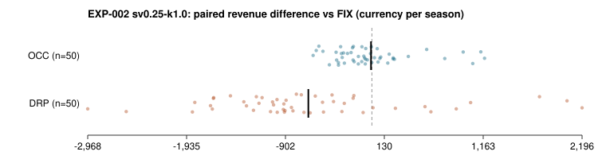

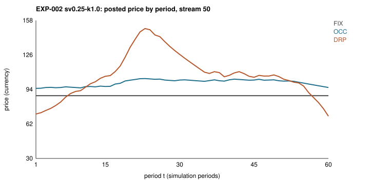

## Cell sv0.25-k2.0 (index 1)

Timing: stream generation 0.05 s; tuning 5400 runs in 0.31 s; evaluation 150 runs in 0.03 s.

### Tuning

| Arm | Tuned in cell | Configs x streams | Selected | Mean tuning revenue | At grid edge | Purchase elasticity at selected FIX price |
|---|---|---|---|---|---|---|
| FIX | sv0.25-k2.0 | 36 x 50 | FIX(p=122.4) | 10,726.96 | no | -1.993 |
| OCC | sv0.25-k2.0 | 36 x 50 | OCC(p0=126.5, k=4) | 11,462.33 | yes | n/a |
| DRP | sv0.25-k2.0 | 36 x 50 | DRP(p0=94.85, eta=0.1, weight=0.3) | 11,670.67 | yes | n/a |

### Arms (per-stream metrics)

| Arm | Policy | n | revenue mean (sd) | sell_through mean (sd) | availability mean (sd) | price_volatility mean (sd) | consumer_surplus mean (sd) | stockout_period mean (sd) |
|---|---|---|---|---|---|---|---|---|
| FIX | FIX(p=122.4) | 50 | 10,981.55 (1,860.21) | 0.90 (0.15) | 0.96 (0.06) | 0.00 (0.00) | 5,550.18 (990.03) | 56.86 (5.15) |
| OCC | OCC(p0=126.5, k=4) | 50 | 11,795.63 (1,898.41) | 0.98 (0.05) | 0.97 (0.03) | 0.04 (0.00) | 5,716.56 (494.36) | 57.98 (2.50) |
| DRP | DRP(p0=94.85, eta=0.1, weight=0.3) | 50 | 11,890.25 (1,827.40) | 0.99 (0.02) | 0.98 (0.02) | 0.03 (0.01) | 5,452.43 (654.74) | 58.80 (2.38) |

### Paired contrasts

| Arm | vs | Metric | n | Mean paired diff | SD diff | d_z | Level | Bootstrap CI | t CI | Relative | Class |
|---|---|---|---|---|---|---|---|---|---|---|---|
| OCC | FIX | revenue | 50 | 814.084 | 750.153 | 1.085 | 0.95 | [611.711, 1,024.913] | [600.893, 1,027.275] | 7.41% | detectable_practically_relevant |
| DRP | FIX | revenue | 50 | 908.708 | 830.375 | 1.094 | 0.95 | [679.064, 1,140.851] | [672.718, 1,144.697] | 8.27% | detectable_practically_relevant |
| OCC | FIX | sell_through | 50 | 0.079 | 0.112 | 0.705 | 0.95 | [0.050, 0.111] | [0.047, 0.111] | 8.83% | n/a |
| OCC | FIX | availability | 50 | 0.016 | 0.044 | 0.366 | 0.95 | [0.004, 0.028] | [0.004, 0.028] | 1.67% | n/a |
| OCC | FIX | consumer_surplus | 50 | 166.380 | 1,082.087 | 0.154 | 0.95 | [-122.517, 467.980] | [-141.146, 473.906] | 3.00% | n/a |
| OCC | FIX | total_surplus | 50 | 980.464 | 1,269.892 | 0.772 | 0.95 | [631.258, 1,330.578] | [619.564, 1,341.363] | 5.93% | n/a |
| DRP | FIX | sell_through | 50 | 0.092 | 0.141 | 0.653 | 0.95 | [0.056, 0.133] | [0.052, 0.132] | 10.28% | n/a |
| DRP | FIX | availability | 50 | 0.025 | 0.057 | 0.449 | 0.95 | [0.010, 0.041] | [0.009, 0.042] | 2.66% | n/a |
| DRP | FIX | consumer_surplus | 50 | -97.749 | 1,398.586 | -0.070 | 0.95 | [-468.291, 296.321] | [-495.222, 299.725] | -1.76% | n/a |
| DRP | FIX | total_surplus | 50 | 810.959 | 1,623.204 | 0.500 | 0.95 | [373.443, 1,270.782] | [349.649, 1,272.269] | 4.91% | n/a |

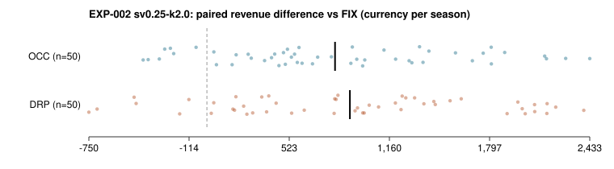

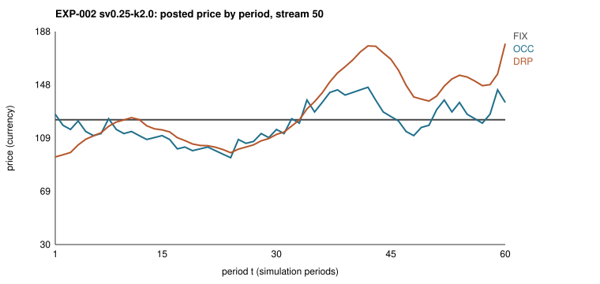

## Cell sv0.25-k4.0 (index 2)

Timing: stream generation 0.05 s; tuning 5400 runs in 0.32 s; evaluation 150 runs in 0.04 s.

### Tuning

| Arm | Tuned in cell | Configs x streams | Selected | Mean tuning revenue | At grid edge | Purchase elasticity at selected FIX price |
|---|---|---|---|---|---|---|
| FIX | sv0.25-k4.0 | 36 x 50 | FIX(p=170.1) | 15,643.17 | no | -2.156 |
| OCC | sv0.25-k4.0 | 36 x 50 | OCC(p0=224.9, k=4) | 16,433.50 | yes | n/a |
| DRP | sv0.25-k4.0 | 36 x 50 | DRP(p0=126.5, eta=0.1, weight=0.3) | 15,952.81 | yes | n/a |

### Arms (per-stream metrics)

| Arm | Policy | n | revenue mean (sd) | sell_through mean (sd) | availability mean (sd) | price_volatility mean (sd) | consumer_surplus mean (sd) | stockout_period mean (sd) |
|---|---|---|---|---|---|---|---|---|
| FIX | FIX(p=170.1) | 50 | 15,428.88 (2,130.86) | 0.91 (0.13) | 0.97 (0.05) | 0.00 (0.00) | 4,932.53 (704.96) | 57.78 (4.77) |
| OCC | OCC(p0=224.9, k=4) | 50 | 16,087.86 (1,842.61) | 0.97 (0.03) | 1.00 (0.01) | 0.05 (0.00) | 5,208.51 (582.21) | 60.56 (0.81) |
| DRP | DRP(p0=126.5, eta=0.1, weight=0.3) | 50 | 15,753.94 (1,481.46) | 1.00 (0.01) | 0.98 (0.02) | 0.03 (0.01) | 4,929.33 (588.74) | 58.86 (1.74) |

### Paired contrasts

| Arm | vs | Metric | n | Mean paired diff | SD diff | d_z | Level | Bootstrap CI | t CI | Relative | Class |
|---|---|---|---|---|---|---|---|---|---|---|---|
| OCC | FIX | revenue | 50 | 658.975 | 1,042.969 | 0.632 | 0.95 | [377.900, 950.788] | [362.567, 955.383] | 4.27% | detectable_practically_relevant |
| DRP | FIX | revenue | 50 | 325.060 | 1,230.743 | 0.264 | 0.95 | [-3.947, 668.176] | [-24.713, 674.833] | 2.11% | inconclusive |
| OCC | FIX | sell_through | 50 | 0.066 | 0.106 | 0.623 | 0.95 | [0.039, 0.096] | [0.036, 0.096] | 7.28% | n/a |
| OCC | FIX | availability | 50 | 0.028 | 0.046 | 0.611 | 0.95 | [0.016, 0.042] | [0.015, 0.042] | 2.93% | n/a |
| OCC | FIX | consumer_surplus | 50 | 275.984 | 987.385 | 0.280 | 0.95 | [15.755, 554.300] | [-4.628, 556.596] | 5.60% | n/a |
| OCC | FIX | total_surplus | 50 | 934.959 | 1,648.993 | 0.567 | 0.95 | [497.309, 1,400.728] | [466.320, 1,403.598] | 4.59% | n/a |
| DRP | FIX | sell_through | 50 | 0.090 | 0.125 | 0.722 | 0.95 | [0.058, 0.126] | [0.055, 0.126] | 9.94% | n/a |
| DRP | FIX | availability | 50 | 0.014 | 0.056 | 0.256 | 0.95 | [-0.000, 0.031] | [-0.002, 0.031] | 1.50% | n/a |
| DRP | FIX | consumer_surplus | 50 | -3.198 | 1,042.243 | -0.003 | 0.95 | [-280.204, 293.297] | [-299.400, 293.004] | -0.06% | n/a |
| DRP | FIX | total_surplus | 50 | 321.862 | 1,987.413 | 0.162 | 0.95 | [-190.511, 888.090] | [-242.955, 886.679] | 1.58% | n/a |

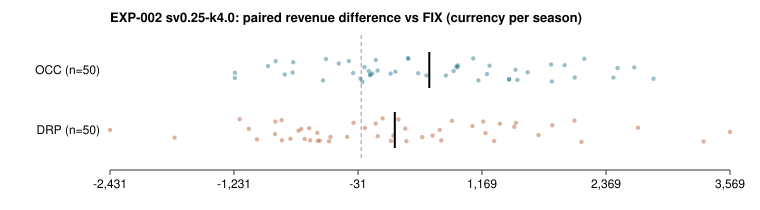

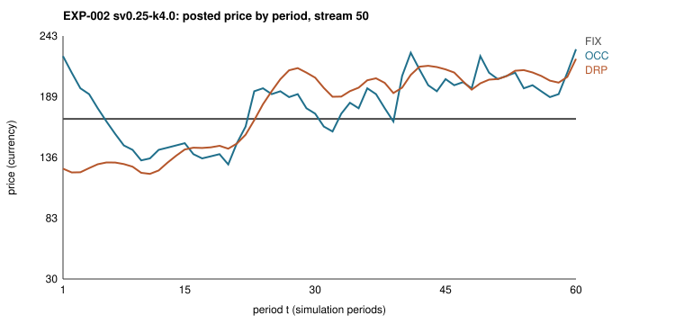

## Cell sv0.5-k1.0 (index 3)

Timing: stream generation 0.04 s; tuning 5400 runs in 0.30 s; evaluation 150 runs in 0.03 s.

### Tuning

| Arm | Tuned in cell | Configs x streams | Selected | Mean tuning revenue | At grid edge | Purchase elasticity at selected FIX price |
|---|---|---|---|---|---|---|
| FIX | sv0.5-k1.0 | 36 x 50 | FIX(p=100.5) | 6,753.96 | no | -1.047 |
| OCC | sv0.5-k1.0 | 36 x 50 | OCC(p0=94.85, k=0.5) | 6,656.79 | yes | n/a |
| DRP | sv0.5-k1.0 | 36 x 50 | DRP(p0=71.13, eta=0.1, weight=0.3) | 5,787.54 | yes | n/a |

### Arms (per-stream metrics)

| Arm | Policy | n | revenue mean (sd) | sell_through mean (sd) | availability mean (sd) | price_volatility mean (sd) | consumer_surplus mean (sd) | stockout_period mean (sd) |
|---|---|---|---|---|---|---|---|---|
| FIX | FIX(p=100.5) | 50 | 6,643.44 (1,785.13) | 0.66 (0.18) | 0.99 (0.03) | 0.00 (0.00) | 6,140.77 (1,644.70) | 60.24 (2.77) |
| OCC | OCC(p0=94.85, k=0.5) | 50 | 6,589.14 (1,797.50) | 0.73 (0.16) | 0.99 (0.04) | 0.01 (0.00) | 6,779.77 (1,501.19) | 60.02 (3.20) |
| DRP | DRP(p0=71.13, eta=0.1, weight=0.3) | 50 | 5,738.78 (2,575.83) | 0.85 (0.12) | 1.00 (0.00) | 0.02 (0.01) | 8,640.12 (1,169.05) | 60.78 (0.68) |

### Paired contrasts

| Arm | vs | Metric | n | Mean paired diff | SD diff | d_z | Level | Bootstrap CI | t CI | Relative | Class |
|---|---|---|---|---|---|---|---|---|---|---|---|
| OCC | FIX | revenue | 50 | -54.295 | 229.433 | -0.237 | 0.95 | [-117.931, 7.648] | [-119.499, 10.910] | -0.82% | inconclusive |
| DRP | FIX | revenue | 50 | -904.655 | 1,001.817 | -0.903 | 0.95 | [-1,176.767, -623.479] | [-1,189.368, -619.941] | -13.62% | detectable_practically_relevant |
| OCC | FIX | sell_through | 50 | 0.065 | 0.029 | 2.217 | 0.95 | [0.057, 0.073] | [0.057, 0.074] | 9.89% | n/a |
| OCC | FIX | availability | 50 | -0.002 | 0.008 | -0.292 | 0.95 | [-0.005, -0.001] | [-0.005, -0.000] | -0.24% | n/a |
| OCC | FIX | consumer_surplus | 50 | 639.003 | 288.893 | 2.212 | 0.95 | [556.753, 713.166] | [556.900, 721.105] | 10.41% | n/a |
| OCC | FIX | total_surplus | 50 | 584.708 | 371.126 | 1.575 | 0.95 | [478.115, 679.908] | [479.235, 690.181] | 4.57% | n/a |
| DRP | FIX | sell_through | 50 | 0.192 | 0.092 | 2.099 | 0.95 | [0.166, 0.216] | [0.166, 0.218] | 29.07% | n/a |
| DRP | FIX | availability | 50 | 0.007 | 0.033 | 0.197 | 0.95 | [-0.000, 0.017] | [-0.003, 0.016] | 0.66% | n/a |
| DRP | FIX | consumer_surplus | 50 | 2,499.348 | 1,380.533 | 1.810 | 0.95 | [2,110.084, 2,860.698] | [2,107.005, 2,891.691] | 40.70% | n/a |
| DRP | FIX | total_surplus | 50 | 1,594.694 | 671.887 | 2.373 | 0.95 | [1,408.690, 1,774.017] | [1,403.746, 1,785.642] | 12.47% | n/a |

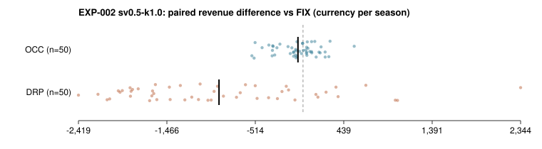

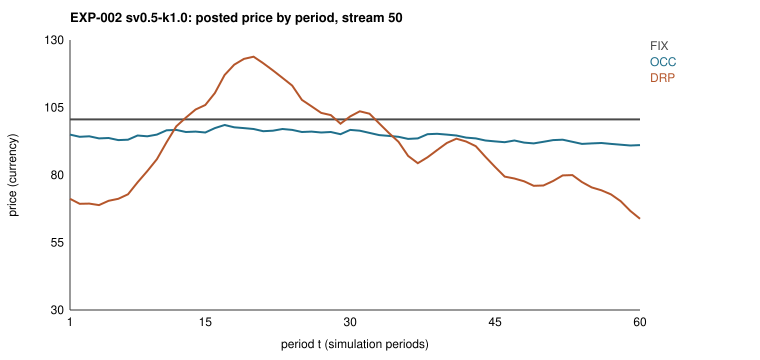

## Cell sv0.5-k2.0 (index 4)

Timing: stream generation 0.05 s; tuning 5400 runs in 0.31 s; evaluation 150 runs in 0.03 s.

### Tuning

| Arm | Tuned in cell | Configs x streams | Selected | Mean tuning revenue | At grid edge | Purchase elasticity at selected FIX price |
|---|---|---|---|---|---|---|
| FIX | sv0.5-k2.0 | 36 x 50 | FIX(p=130.7) | 11,521.76 | no | -1.452 |
| OCC | sv0.5-k2.0 | 36 x 50 | OCC(p0=126.5, k=4) | 11,876.53 | yes | n/a |
| DRP | sv0.5-k2.0 | 36 x 50 | DRP(p0=94.85, eta=0.1, weight=0.3) | 11,895.26 | yes | n/a |

### Arms (per-stream metrics)

| Arm | Policy | n | revenue mean (sd) | sell_through mean (sd) | availability mean (sd) | price_volatility mean (sd) | consumer_surplus mean (sd) | stockout_period mean (sd) |
|---|---|---|---|---|---|---|---|---|
| FIX | FIX(p=130.7) | 50 | 11,550.52 (1,955.34) | 0.88 (0.15) | 0.94 (0.11) | 0.00 (0.00) | 8,013.46 (1,606.91) | 55.78 (8.35) |
| OCC | OCC(p0=126.5, k=4) | 50 | 12,160.74 (2,681.76) | 0.97 (0.06) | 0.98 (0.03) | 0.04 (0.00) | 8,938.63 (1,113.29) | 58.52 (2.78) |
| DRP | DRP(p0=94.85, eta=0.1, weight=0.3) | 50 | 12,103.56 (2,866.20) | 0.99 (0.03) | 0.98 (0.02) | 0.03 (0.01) | 8,888.80 (1,052.93) | 58.94 (2.06) |

### Paired contrasts

| Arm | vs | Metric | n | Mean paired diff | SD diff | d_z | Level | Bootstrap CI | t CI | Relative | Class |
|---|---|---|---|---|---|---|---|---|---|---|---|
| OCC | FIX | revenue | 50 | 610.222 | 1,289.110 | 0.473 | 0.95 | [270.844, 973.217] | [243.861, 976.583] | 5.28% | detectable_practically_relevant |
| DRP | FIX | revenue | 50 | 553.048 | 1,482.813 | 0.373 | 0.95 | [154.597, 975.209] | [131.637, 974.458] | 4.79% | detectable_practically_relevant |
| OCC | FIX | sell_through | 50 | 0.083 | 0.105 | 0.789 | 0.95 | [0.055, 0.113] | [0.053, 0.113] | 9.39% | n/a |
| OCC | FIX | availability | 50 | 0.040 | 0.086 | 0.467 | 0.95 | [0.018, 0.065] | [0.016, 0.065] | 4.31% | n/a |
| OCC | FIX | consumer_surplus | 50 | 925.171 | 1,207.846 | 0.766 | 0.95 | [602.405, 1,265.154] | [581.905, 1,268.437] | 11.55% | n/a |
| OCC | FIX | total_surplus | 50 | 1,535.393 | 1,555.392 | 0.987 | 0.95 | [1,106.650, 1,979.000] | [1,093.356, 1,977.431] | 7.85% | n/a |
| DRP | FIX | sell_through | 50 | 0.105 | 0.138 | 0.764 | 0.95 | [0.069, 0.144] | [0.066, 0.145] | 11.93% | n/a |
| DRP | FIX | availability | 50 | 0.044 | 0.112 | 0.397 | 0.95 | [0.015, 0.076] | [0.013, 0.076] | 4.72% | n/a |
| DRP | FIX | consumer_surplus | 50 | 875.338 | 1,627.172 | 0.538 | 0.95 | [439.500, 1,335.304] | [412.901, 1,337.775] | 10.92% | n/a |
| DRP | FIX | total_surplus | 50 | 1,428.386 | 1,872.851 | 0.763 | 0.95 | [915.688, 1,958.700] | [896.127, 1,960.644] | 7.30% | n/a |

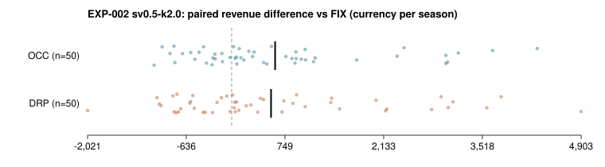

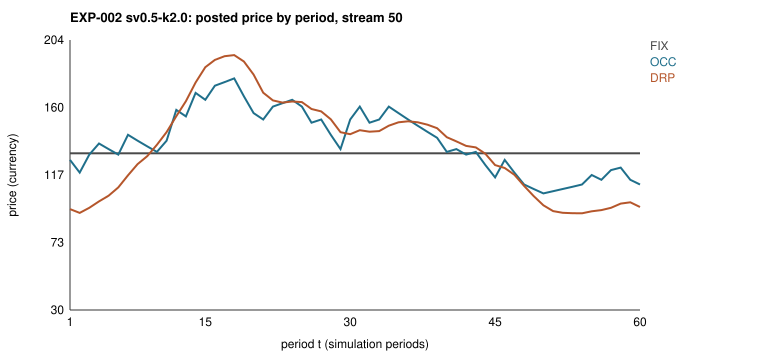

## Cell sv0.5-k4.0 (index 5)

Timing: stream generation 0.05 s; tuning 5400 runs in 0.32 s; evaluation 150 runs in 0.04 s.

### Tuning

| Arm | Tuned in cell | Configs x streams | Selected | Mean tuning revenue | At grid edge | Purchase elasticity at selected FIX price |
|---|---|---|---|---|---|---|
| FIX | sv0.5-k4.0 | 36 x 50 | FIX(p=194) | 17,047.64 | no | -2.121 |
| OCC | sv0.5-k4.0 | 36 x 50 | OCC(p0=224.9, k=4) | 18,552.71 | yes | n/a |
| DRP | sv0.5-k4.0 | 36 x 50 | DRP(p0=168.7, eta=0.1, weight=0.3) | 18,267.64 | yes | n/a |

### Arms (per-stream metrics)

| Arm | Policy | n | revenue mean (sd) | sell_through mean (sd) | availability mean (sd) | price_volatility mean (sd) | consumer_surplus mean (sd) | stockout_period mean (sd) |
|---|---|---|---|---|---|---|---|---|
| FIX | FIX(p=194) | 50 | 17,361.90 (2,821.85) | 0.90 (0.15) | 0.96 (0.06) | 0.00 (0.00) | 8,589.59 (1,596.10) | 57.72 (4.89) |
| OCC | OCC(p0=224.9, k=4) | 50 | 18,392.47 (2,446.63) | 0.98 (0.03) | 0.99 (0.02) | 0.05 (0.00) | 9,388.48 (1,204.35) | 59.62 (1.68) |
| DRP | DRP(p0=168.7, eta=0.1, weight=0.3) | 50 | 18,188.78 (2,291.77) | 0.99 (0.01) | 0.98 (0.03) | 0.03 (0.01) | 9,181.50 (1,128.88) | 58.92 (2.29) |

### Paired contrasts

| Arm | vs | Metric | n | Mean paired diff | SD diff | d_z | Level | Bootstrap CI | t CI | Relative | Class |
|---|---|---|---|---|---|---|---|---|---|---|---|
| OCC | FIX | revenue | 50 | 1,030.569 | 1,121.883 | 0.919 | 0.95 | [728.763, 1,335.525] | [711.733, 1,349.405] | 5.94% | detectable_practically_relevant |
| DRP | FIX | revenue | 50 | 826.874 | 1,329.815 | 0.622 | 0.95 | [465.384, 1,185.601] | [448.945, 1,204.803] | 4.76% | detectable_practically_relevant |
| OCC | FIX | sell_through | 50 | 0.083 | 0.120 | 0.687 | 0.95 | [0.051, 0.118] | [0.049, 0.117] | 9.25% | n/a |
| OCC | FIX | availability | 50 | 0.023 | 0.048 | 0.490 | 0.95 | [0.011, 0.037] | [0.010, 0.037] | 2.43% | n/a |
| OCC | FIX | consumer_surplus | 50 | 798.882 | 1,237.517 | 0.646 | 0.95 | [470.005, 1,144.989] | [447.184, 1,150.581] | 9.30% | n/a |
| OCC | FIX | total_surplus | 50 | 1,829.452 | 2,026.570 | 0.903 | 0.95 | [1,287.440, 2,394.314] | [1,253.507, 2,405.396] | 7.05% | n/a |
| DRP | FIX | sell_through | 50 | 0.098 | 0.147 | 0.668 | 0.95 | [0.060, 0.141] | [0.057, 0.140] | 10.99% | n/a |
| DRP | FIX | availability | 50 | 0.013 | 0.066 | 0.202 | 0.95 | [-0.004, 0.032] | [-0.005, 0.032] | 1.38% | n/a |
| DRP | FIX | consumer_surplus | 50 | 591.907 | 1,540.166 | 0.384 | 0.95 | [192.906, 1,024.073] | [154.197, 1,029.618] | 6.89% | n/a |
| DRP | FIX | total_surplus | 50 | 1,418.781 | 2,477.771 | 0.573 | 0.95 | [772.884, 2,113.305] | [714.606, 2,122.956] | 5.47% | n/a |

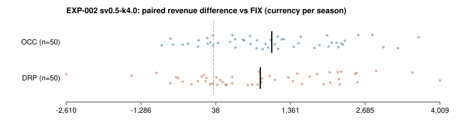

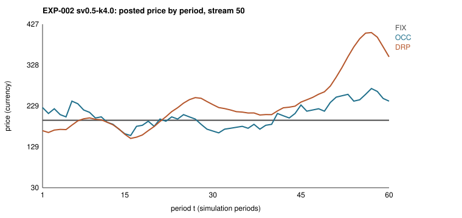

## Cell sv1.0-k1.0 (index 6)

Timing: stream generation 0.05 s; tuning 5400 runs in 0.31 s; evaluation 150 runs in 0.03 s.

### Tuning

| Arm | Tuned in cell | Configs x streams | Selected | Mean tuning revenue | At grid edge | Purchase elasticity at selected FIX price |
|---|---|---|---|---|---|---|
| FIX | sv1.0-k1.0 | 36 x 50 | FIX(p=207.2) | 7,139.39 | no | -1.080 |
| OCC | sv1.0-k1.0 | 36 x 50 | OCC(p0=224.9, k=0.5) | 7,060.02 | yes | n/a |
| DRP | sv1.0-k1.0 | 36 x 50 | DRP(p0=126.5, eta=0.1, weight=0.3) | 4,996.98 | yes | n/a |

### Arms (per-stream metrics)

| Arm | Policy | n | revenue mean (sd) | sell_through mean (sd) | availability mean (sd) | price_volatility mean (sd) | consumer_surplus mean (sd) | stockout_period mean (sd) |
|---|---|---|---|---|---|---|---|---|
| FIX | FIX(p=207.2) | 50 | 7,077.23 (2,666.48) | 0.34 (0.13) | 1.00 (0.00) | 0.00 (0.00) | 9,611.56 (4,099.29) | 61.00 (0.00) |
| OCC | OCC(p0=224.9, k=0.5) | 50 | 6,997.18 (2,589.52) | 0.36 (0.12) | 1.00 (0.00) | 0.01 (0.00) | 10,045.38 (4,021.68) | 61.00 (0.00) |
| DRP | DRP(p0=126.5, eta=0.1, weight=0.3) | 50 | 5,050.07 (2,537.15) | 0.74 (0.15) | 1.00 (0.00) | 0.03 (0.00) | 16,474.97 (4,824.66) | 61.00 (0.00) |

### Paired contrasts

| Arm | vs | Metric | n | Mean paired diff | SD diff | d_z | Level | Bootstrap CI | t CI | Relative | Class |
|---|---|---|---|---|---|---|---|---|---|---|---|
| OCC | FIX | revenue | 50 | -80.059 | 330.002 | -0.243 | 0.95 | [-171.184, 10.983] | [-173.845, 13.726] | -1.13% | inconclusive |
| DRP | FIX | revenue | 50 | -2,027.169 | 985.398 | -2.057 | 0.95 | [-2,285.835, -1,748.054] | [-2,307.216, -1,747.122] | -28.64% | detectable_practically_relevant |
| OCC | FIX | sell_through | 50 | 0.019 | 0.018 | 1.091 | 0.95 | [0.014, 0.024] | [0.014, 0.024] | 5.62% | n/a |
| OCC | FIX | availability | 50 | 0.000 | 0.000 | n/a | 0.95 | [0.000, 0.000] | [0.000, 0.000] | 0.00% | n/a |
| OCC | FIX | consumer_surplus | 50 | 433.826 | 188.626 | 2.300 | 0.95 | [380.993, 484.147] | [380.219, 487.432] | 4.51% | n/a |
| OCC | FIX | total_surplus | 50 | 353.767 | 340.312 | 1.040 | 0.95 | [259.059, 447.341] | [257.051, 450.482] | 2.12% | n/a |
| DRP | FIX | sell_through | 50 | 0.394 | 0.075 | 5.272 | 0.95 | [0.373, 0.414] | [0.372, 0.415] | 115.22% | n/a |
| DRP | FIX | availability | 50 | 0.000 | 0.000 | n/a | 0.95 | [0.000, 0.000] | [0.000, 0.000] | 0.00% | n/a |
| DRP | FIX | consumer_surplus | 50 | 6,863.412 | 1,212.468 | 5.661 | 0.95 | [6,523.051, 7,200.299] | [6,518.832, 7,207.992] | 71.41% | n/a |
| DRP | FIX | total_surplus | 50 | 4,836.243 | 1,068.121 | 4.528 | 0.95 | [4,533.738, 5,135.171] | [4,532.686, 5,139.800] | 28.98% | n/a |

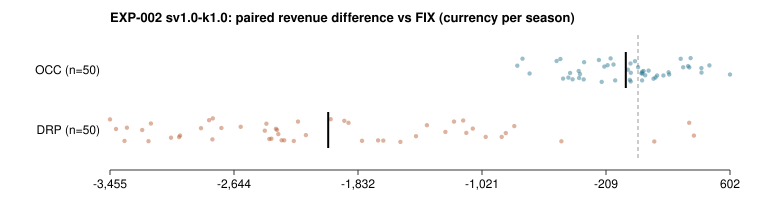

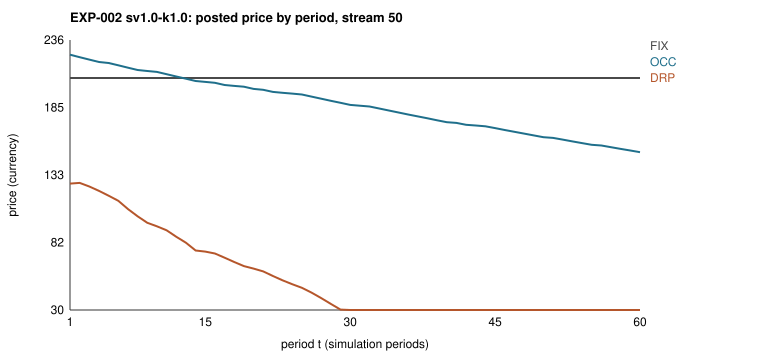

## Cell sv1.0-k2.0 (index 7)

Timing: stream generation 0.05 s; tuning 5400 runs in 0.34 s; evaluation 150 runs in 0.03 s.

### Tuning

| Arm | Tuned in cell | Configs x streams | Selected | Mean tuning revenue | At grid edge | Purchase elasticity at selected FIX price |
|---|---|---|---|---|---|---|
| FIX | sv1.0-k2.0 | 36 x 50 | FIX(p=207.2) | 14,108.89 | no | -1.080 |
| OCC | sv1.0-k2.0 | 36 x 50 | OCC(p0=224.9, k=0.5) | 14,053.20 | yes | n/a |
| DRP | sv1.0-k2.0 | 36 x 50 | DRP(p0=126.5, eta=0.1, weight=0.3) | 13,218.37 | yes | n/a |

### Arms (per-stream metrics)

| Arm | Policy | n | revenue mean (sd) | sell_through mean (sd) | availability mean (sd) | price_volatility mean (sd) | consumer_surplus mean (sd) | stockout_period mean (sd) |
|---|---|---|---|---|---|---|---|---|
| FIX | FIX(p=207.2) | 50 | 12,965.26 (3,934.08) | 0.63 (0.19) | 0.99 (0.03) | 0.00 (0.00) | 18,015.61 (6,626.03) | 60.36 (2.93) |
| OCC | OCC(p0=224.9, k=0.5) | 50 | 13,052.71 (4,152.60) | 0.63 (0.17) | 0.99 (0.03) | 0.01 (0.00) | 18,054.19 (6,233.89) | 60.54 (2.53) |
| DRP | DRP(p0=126.5, eta=0.1, weight=0.3) | 50 | 12,329.16 (5,001.94) | 0.95 (0.05) | 0.99 (0.01) | 0.03 (0.01) | 23,509.76 (4,643.46) | 60.14 (1.54) |

### Paired contrasts

| Arm | vs | Metric | n | Mean paired diff | SD diff | d_z | Level | Bootstrap CI | t CI | Relative | Class |
|---|---|---|---|---|---|---|---|---|---|---|---|
| OCC | FIX | revenue | 50 | 87.445 | 641.918 | 0.136 | 0.95 | [-76.966, 275.985] | [-94.986, 269.876] | 0.67% | inconclusive |
| DRP | FIX | revenue | 50 | -636.104 | 1,719.256 | -0.370 | 0.95 | [-1,077.463, -129.477] | [-1,124.711, -147.497] | -4.91% | detectable_practically_relevant |
| OCC | FIX | sell_through | 50 | 0.002 | 0.030 | 0.066 | 0.95 | [-0.006, 0.010] | [-0.007, 0.011] | 0.32% | n/a |
| OCC | FIX | availability | 50 | 0.002 | 0.009 | 0.245 | 0.95 | [0.000, 0.005] | [-0.000, 0.005] | 0.22% | n/a |
| OCC | FIX | consumer_surplus | 50 | 38.580 | 645.508 | 0.060 | 0.95 | [-148.271, 205.664] | [-144.872, 222.031] | 0.21% | n/a |
| OCC | FIX | total_surplus | 50 | 126.025 | 787.460 | 0.160 | 0.95 | [-84.802, 353.322] | [-97.768, 349.819] | 0.41% | n/a |
| DRP | FIX | sell_through | 50 | 0.328 | 0.158 | 2.076 | 0.95 | [0.285, 0.371] | [0.283, 0.373] | 52.48% | n/a |
| DRP | FIX | availability | 50 | 0.001 | 0.033 | 0.021 | 0.95 | [-0.007, 0.011] | [-0.009, 0.010] | 0.07% | n/a |
| DRP | FIX | consumer_surplus | 50 | 5,494.155 | 2,720.767 | 2.019 | 0.95 | [4,731.475, 6,226.301] | [4,720.921, 6,267.388] | 30.50% | n/a |
| DRP | FIX | total_surplus | 50 | 4,858.051 | 2,224.826 | 2.184 | 0.95 | [4,212.634, 5,446.971] | [4,225.762, 5,490.340] | 15.68% | n/a |

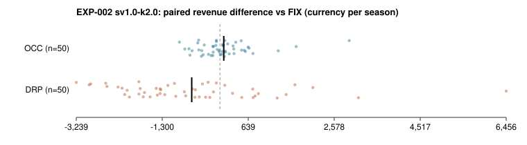

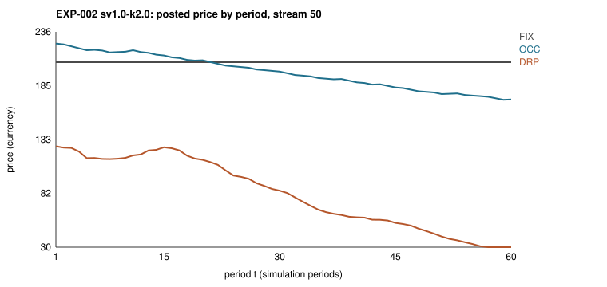

## Cell sv1.0-k4.0 (index 8)

Timing: stream generation 0.05 s; tuning 5400 runs in 0.32 s; evaluation 150 runs in 0.03 s.

### Tuning

| Arm | Tuned in cell | Configs x streams | Selected | Mean tuning revenue | At grid edge | Purchase elasticity at selected FIX price |
|---|---|---|---|---|---|---|
| FIX | sv1.0-k4.0 | 36 x 50 | FIX(p=307.4) | 24,429.96 | no | -1.345 |
| OCC | sv1.0-k4.0 | 36 x 50 | OCC(p0=300, k=4) | 25,170.60 | yes | n/a |
| DRP | sv1.0-k4.0 | 36 x 50 | DRP(p0=168.7, eta=0.1, weight=0.3) | 24,784.62 | yes | n/a |

### Arms (per-stream metrics)

| Arm | Policy | n | revenue mean (sd) | sell_through mean (sd) | availability mean (sd) | price_volatility mean (sd) | consumer_surplus mean (sd) | stockout_period mean (sd) |
|---|---|---|---|---|---|---|---|---|
| FIX | FIX(p=307.4) | 50 | 25,167.84 (4,349.78) | 0.82 (0.14) | 0.98 (0.06) | 0.00 (0.00) | 26,585.46 (7,062.20) | 59.26 (4.76) |
| OCC | OCC(p0=300, k=4) | 50 | 25,834.72 (4,842.34) | 0.96 (0.04) | 0.99 (0.02) | 0.04 (0.00) | 30,106.13 (5,177.69) | 60.08 (2.06) |
| DRP | DRP(p0=168.7, eta=0.1, weight=0.3) | 50 | 25,591.34 (4,895.79) | 0.99 (0.01) | 0.98 (0.03) | 0.03 (0.01) | 29,534.46 (4,800.89) | 58.76 (2.09) |

### Paired contrasts

| Arm | vs | Metric | n | Mean paired diff | SD diff | d_z | Level | Bootstrap CI | t CI | Relative | Class |
|---|---|---|---|---|---|---|---|---|---|---|---|
| OCC | FIX | revenue | 50 | 666.878 | 2,012.940 | 0.331 | 0.95 | [153.092, 1,269.078] | [94.807, 1,238.950] | 2.65% | detectable_practically_relevant |
| DRP | FIX | revenue | 50 | 423.498 | 2,159.845 | 0.196 | 0.95 | [-151.045, 1,033.210] | [-190.323, 1,037.319] | 1.68% | inconclusive |
| OCC | FIX | sell_through | 50 | 0.141 | 0.111 | 1.267 | 0.95 | [0.111, 0.172] | [0.109, 0.173] | 17.22% | n/a |
| OCC | FIX | availability | 50 | 0.011 | 0.039 | 0.287 | 0.95 | [0.002, 0.023] | [0.000, 0.022] | 1.15% | n/a |
| OCC | FIX | consumer_surplus | 50 | 3,520.672 | 2,434.140 | 1.446 | 0.95 | [2,848.227, 4,173.987] | [2,828.897, 4,212.447] | 13.24% | n/a |
| OCC | FIX | total_surplus | 50 | 4,187.551 | 2,964.630 | 1.413 | 0.95 | [3,363.388, 4,992.798] | [3,345.012, 5,030.089] | 8.09% | n/a |
| DRP | FIX | sell_through | 50 | 0.175 | 0.140 | 1.251 | 0.95 | [0.137, 0.214] | [0.135, 0.214] | 21.33% | n/a |
| DRP | FIX | availability | 50 | -0.002 | 0.058 | -0.034 | 0.95 | [-0.017, 0.015] | [-0.019, 0.015] | -0.20% | n/a |
| DRP | FIX | consumer_surplus | 50 | 2,948.999 | 3,254.036 | 0.906 | 0.95 | [2,058.216, 3,867.149] | [2,024.212, 3,873.786] | 11.09% | n/a |
| DRP | FIX | total_surplus | 50 | 3,372.497 | 3,708.166 | 0.909 | 0.95 | [2,342.091, 4,393.142] | [2,318.648, 4,426.346] | 6.52% | n/a |

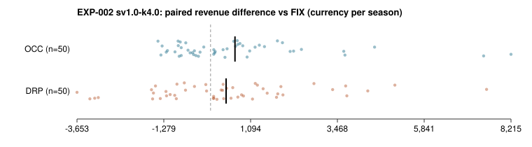

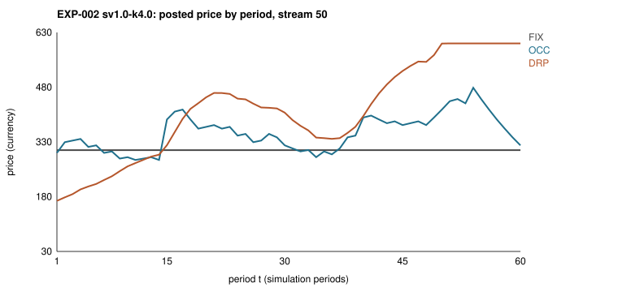

## Multiplicity across cells (revenue vs FIX, Holm over all listed contrasts)

| Cell | Arm | n | Mean paired revenue diff | Sign-flip p | Holm-adjusted p |
|---|---|---|---|---|---|
| sv0.25-k1.0 | OCC | 50 | -8.971 | 0.8754 | 0.8754 |
| sv0.25-k1.0 | DRP | 50 | -663.776 | 0.0002 | 0.0024 |
| sv0.25-k2.0 | OCC | 50 | 814.084 | 0.0001 | 0.0018 |
| sv0.25-k2.0 | DRP | 50 | 908.708 | 0.0001 | 0.0018 |
| sv0.25-k4.0 | OCC | 50 | 658.975 | 0.0001 | 0.0018 |
| sv0.25-k4.0 | DRP | 50 | 325.060 | 0.0671 | 0.4026 |
| sv0.5-k1.0 | OCC | 50 | -54.295 | 0.1012 | 0.4760 |
| sv0.5-k1.0 | DRP | 50 | -904.655 | 0.0001 | 0.0018 |
| sv0.5-k2.0 | OCC | 50 | 610.222 | 0.0017 | 0.0170 |
| sv0.5-k2.0 | DRP | 50 | 553.048 | 0.0112 | 0.1008 |
| sv0.5-k4.0 | OCC | 50 | 1,030.569 | 0.0001 | 0.0018 |
| sv0.5-k4.0 | DRP | 50 | 826.874 | 0.0002 | 0.0024 |
| sv1.0-k1.0 | OCC | 50 | -80.059 | 0.0952 | 0.4760 |
| sv1.0-k1.0 | DRP | 50 | -2,027.169 | 0.0001 | 0.0018 |
| sv1.0-k2.0 | OCC | 50 | 87.445 | 0.3626 | 0.7251 |
| sv1.0-k2.0 | DRP | 50 | -636.104 | 0.0114 | 0.1008 |
| sv1.0-k4.0 | OCC | 50 | 666.878 | 0.0187 | 0.1309 |
| sv1.0-k4.0 | DRP | 50 | 423.498 | 0.1693 | 0.5078 |
