<!-- SPDX-License-Identifier: LicenseRef-FARE-NC-Research-1.0 -->
# EXP-003 run set EXP-003-exp-pilot-exp003-20261124T161055Z

**EXPLORATORY. Not evidence.** Produced before the owner froze the protocol; exploratory runs are never reported as findings.

All numbers are simulated and hold only within the model of `research/protocol.md`.

- Created (UTC): 2026-11-24T16:10:57Z
- Config SHA-256: `2f28ab5ad7dcddb03895d0f3a6833e31977d8b9db11e1661a427d3b48034b6e2`
- Protocol: `research/experiments/EXP-003/protocol.md` SHA-256 `a7b83e766343b301f42615a36ed9e5b23b878a53b984b862182207d5bc0810e4`, frozen: False
- Failed runs: 0
- Manifest: `run_manifest.json`

EXPLORATORY PILOT for EXP-003, run before the owner's freeze. Tuning streams only: policies are tuned on tuning streams 0-49 and evaluated on tuning streams 50-99; evaluation streams (role 1) are never generated. Purpose: runtime per run, projected full-matrix time, spread of paired differences between streams (seed-count adequacy) and degenerate cells or grid-edge optima. Not evidence and never reported as a finding.

## Cell base-tuning (index 0)

Timing: stream generation 0.03 s; tuning 5400 runs in 0.30 s; evaluation 0 runs in 0.00 s.

### Tuning

| Arm | Tuned in cell | Configs x streams | Selected | Mean tuning revenue | At grid edge | Purchase elasticity at selected FIX price |
|---|---|---|---|---|---|---|
| FIX | base-tuning | 36 x 50 | FIX(p=139.6) | 11,892.00 | no | -1.557 |
| OCC | base-tuning | 36 x 50 | OCC(p0=126.5, k=4) | 12,397.45 | yes | n/a |
| DRP | base-tuning | 36 x 50 | DRP(p0=94.85, eta=0.1, weight=0.3) | 12,501.49 | yes | n/a |

### Arms (per-stream metrics)

| Arm | Policy | n | revenue mean (sd) | sell_through mean (sd) | availability mean (sd) | price_volatility mean (sd) | consumer_surplus mean (sd) | stockout_period mean (sd) |
|---|---|---|---|---|---|---|---|---|

### Paired contrasts

_No contrasts (no FIX arm)._

## Cell demand-x0.6 (index 1)

Timing: stream generation 0.04 s; tuning 1800 runs in 0.10 s; evaluation 200 runs in 0.04 s.

### Tuning

| Arm | Tuned in cell | Configs x streams | Selected | Mean tuning revenue | At grid edge | Purchase elasticity at selected FIX price |
|---|---|---|---|---|---|---|
| FIX | base-tuning | 36 x 50 | FIX(p=139.6) | 11,892.00 | no | -1.557 |
| OCC | base-tuning | 36 x 50 | OCC(p0=126.5, k=4) | 12,397.45 | yes | n/a |
| DRP | base-tuning | 36 x 50 | DRP(p0=94.85, eta=0.1, weight=0.3) | 12,501.49 | yes | n/a |
| FIX_retuned | demand-x0.6 | 36 x 50 | FIX(p=114.6) | 7,813.76 | no | -1.247 |

### Arms (per-stream metrics)

| Arm | Policy | n | revenue mean (sd) | sell_through mean (sd) | availability mean (sd) | price_volatility mean (sd) | consumer_surplus mean (sd) | stockout_period mean (sd) |
|---|---|---|---|---|---|---|---|---|
| FIX | FIX(p=139.6) | 50 | 6,935.83 (1,847.50) | 0.50 (0.13) | 1.00 (0.00) | 0.00 (0.00) | 4,644.40 (1,468.93) | 61.00 (0.00) |
| OCC | OCC(p0=126.5, k=4) | 50 | 6,999.94 (2,117.11) | 0.80 (0.12) | 1.00 (0.00) | 0.04 (0.00) | 7,950.61 (1,270.37) | 60.98 (0.14) |
| DRP | DRP(p0=94.85, eta=0.1, weight=0.3) | 50 | 6,663.04 (2,421.52) | 0.89 (0.10) | 1.00 (0.01) | 0.03 (0.00) | 8,967.71 (1,333.67) | 60.74 (0.83) |
| FIX_retuned | FIX(p=114.6) | 50 | 7,524.95 (1,928.80) | 0.66 (0.17) | 1.00 (0.00) | 0.00 (0.00) | 6,065.53 (1,770.86) | 60.82 (0.90) |

### Paired contrasts

| Arm | vs | Metric | n | Mean paired diff | SD diff | d_z | Level | Bootstrap CI | t CI | Relative | Class |
|---|---|---|---|---|---|---|---|---|---|---|---|
| OCC | FIX | revenue | 50 | 64.106 | 814.254 | 0.079 | 0.95 | [-160.252, 285.217] | [-167.303, 295.514] | 0.92% | inconclusive |
| DRP | FIX | revenue | 50 | -272.793 | 1,172.046 | -0.233 | 0.95 | [-591.291, 48.792] | [-605.885, 60.298] | -3.93% | inconclusive |
| OCC | FIX_retuned | revenue | 50 | -525.011 | 517.284 | -1.015 | 0.95 | [-669.885, -389.171] | [-672.022, -378.001] | -6.98% | detectable_practically_relevant |
| DRP | FIX_retuned | revenue | 50 | -861.911 | 858.117 | -1.004 | 0.95 | [-1,095.907, -628.349] | [-1,105.785, -618.037] | -11.45% | detectable_practically_relevant |
| OCC | FIX | sell_through | 50 | 0.303 | 0.067 | 4.512 | 0.95 | [0.284, 0.321] | [0.284, 0.322] | 61.03% | n/a |
| OCC | FIX | availability | 50 | 0.000 | 0.000 | n/a | 0.95 | [0.000, 0.000] | [0.000, 0.000] | 0.00% | n/a |
| OCC | FIX | consumer_surplus | 50 | 3,306.210 | 696.472 | 4.747 | 0.95 | [3,112.318, 3,493.828] | [3,108.275, 3,504.145] | 71.19% | n/a |
| OCC | FIX | total_surplus | 50 | 3,370.316 | 736.086 | 4.579 | 0.95 | [3,163.311, 3,566.063] | [3,161.122, 3,579.509] | 29.10% | n/a |
| DRP | FIX | sell_through | 50 | 0.389 | 0.081 | 4.810 | 0.95 | [0.366, 0.410] | [0.366, 0.412] | 78.22% | n/a |
| DRP | FIX | availability | 50 | -0.003 | 0.009 | -0.305 | 0.95 | [-0.005, -0.001] | [-0.005, -0.000] | -0.26% | n/a |
| DRP | FIX | consumer_surplus | 50 | 4,323.305 | 1,257.954 | 3.437 | 0.95 | [3,972.137, 4,657.395] | [3,965.798, 4,680.812] | 93.09% | n/a |
| DRP | FIX | total_surplus | 50 | 4,050.512 | 856.328 | 4.730 | 0.95 | [3,809.883, 4,279.207] | [3,807.146, 4,293.877] | 34.98% | n/a |

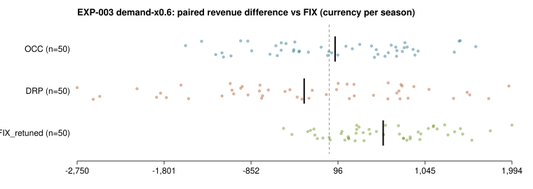

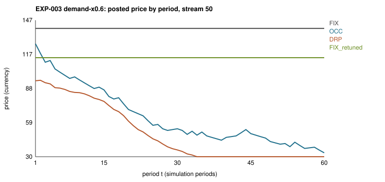

## Cell demand-x0.8 (index 2)

Timing: stream generation 0.05 s; tuning 1800 runs in 0.10 s; evaluation 200 runs in 0.04 s.

### Tuning

| Arm | Tuned in cell | Configs x streams | Selected | Mean tuning revenue | At grid edge | Purchase elasticity at selected FIX price |
|---|---|---|---|---|---|---|
| FIX | base-tuning | 36 x 50 | FIX(p=139.6) | 11,892.00 | no | -1.557 |
| OCC | base-tuning | 36 x 50 | OCC(p0=126.5, k=4) | 12,397.45 | yes | n/a |
| DRP | base-tuning | 36 x 50 | DRP(p0=94.85, eta=0.1, weight=0.3) | 12,501.49 | yes | n/a |
| FIX_retuned | demand-x0.8 | 36 x 50 | FIX(p=130.7) | 10,530.89 | no | -1.452 |

### Arms (per-stream metrics)

| Arm | Policy | n | revenue mean (sd) | sell_through mean (sd) | availability mean (sd) | price_volatility mean (sd) | consumer_surplus mean (sd) | stockout_period mean (sd) |
|---|---|---|---|---|---|---|---|---|
| FIX | FIX(p=139.6) | 50 | 9,889.99 (2,405.98) | 0.71 (0.17) | 1.00 (0.01) | 0.00 (0.00) | 6,814.18 (2,034.03) | 60.74 (1.12) |
| OCC | OCC(p0=126.5, k=4) | 50 | 10,151.05 (2,381.61) | 0.92 (0.08) | 0.99 (0.02) | 0.04 (0.00) | 8,857.65 (1,171.31) | 59.98 (1.96) |
| DRP | DRP(p0=94.85, eta=0.1, weight=0.3) | 50 | 10,090.98 (2,531.21) | 0.97 (0.04) | 0.99 (0.02) | 0.03 (0.00) | 9,226.38 (1,097.78) | 59.88 (1.76) |
| FIX_retuned | FIX(p=130.7) | 50 | 10,023.69 (2,300.29) | 0.77 (0.18) | 0.99 (0.03) | 0.00 (0.00) | 7,304.39 (1,985.02) | 59.74 (3.00) |

### Paired contrasts

| Arm | vs | Metric | n | Mean paired diff | SD diff | d_z | Level | Bootstrap CI | t CI | Relative | Class |
|---|---|---|---|---|---|---|---|---|---|---|---|
| OCC | FIX | revenue | 50 | 261.062 | 650.358 | 0.401 | 0.95 | [78.350, 440.073] | [76.233, 445.892] | 2.64% | detectable_practically_relevant |
| DRP | FIX | revenue | 50 | 200.990 | 687.418 | 0.292 | 0.95 | [11.750, 389.539] | [5.628, 396.352] | 2.03% | detectable_practically_relevant |
| OCC | FIX_retuned | revenue | 50 | 127.354 | 613.829 | 0.207 | 0.95 | [-44.463, 295.583] | [-47.094, 301.803] | 1.27% | inconclusive |
| DRP | FIX_retuned | revenue | 50 | 67.282 | 754.212 | 0.089 | 0.95 | [-136.882, 276.030] | [-147.063, 281.627] | 0.67% | inconclusive |
| OCC | FIX | sell_through | 50 | 0.209 | 0.113 | 1.846 | 0.95 | [0.178, 0.241] | [0.177, 0.241] | 29.50% | n/a |
| OCC | FIX | availability | 50 | -0.006 | 0.014 | -0.437 | 0.95 | [-0.010, -0.003] | [-0.010, -0.002] | -0.61% | n/a |
| OCC | FIX | consumer_surplus | 50 | 2,043.469 | 1,302.424 | 1.569 | 0.95 | [1,685.241, 2,403.387] | [1,673.324, 2,413.613] | 29.99% | n/a |
| OCC | FIX | total_surplus | 50 | 2,304.531 | 1,444.886 | 1.595 | 0.95 | [1,908.360, 2,710.222] | [1,893.899, 2,715.163] | 13.80% | n/a |
| DRP | FIX | sell_through | 50 | 0.259 | 0.152 | 1.701 | 0.95 | [0.217, 0.301] | [0.215, 0.302] | 36.50% | n/a |
| DRP | FIX | availability | 50 | -0.006 | 0.018 | -0.362 | 0.95 | [-0.012, -0.002] | [-0.012, -0.001] | -0.65% | n/a |
| DRP | FIX | consumer_surplus | 50 | 2,412.198 | 1,937.669 | 1.245 | 0.95 | [1,881.868, 2,947.962] | [1,861.519, 2,962.878] | 35.40% | n/a |
| DRP | FIX | total_surplus | 50 | 2,613.188 | 1,889.960 | 1.383 | 0.95 | [2,093.622, 3,144.055] | [2,076.067, 3,150.309] | 15.64% | n/a |

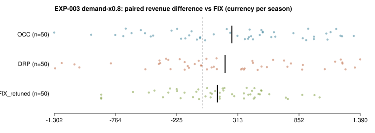

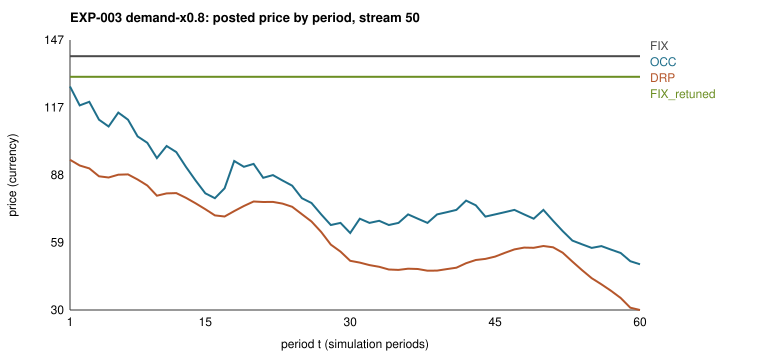

## Cell demand-x1.25 (index 3)

Timing: stream generation 0.05 s; tuning 1800 runs in 0.10 s; evaluation 200 runs in 0.04 s.

### Tuning

| Arm | Tuned in cell | Configs x streams | Selected | Mean tuning revenue | At grid edge | Purchase elasticity at selected FIX price |
|---|---|---|---|---|---|---|
| FIX | base-tuning | 36 x 50 | FIX(p=139.6) | 11,892.00 | no | -1.557 |
| OCC | base-tuning | 36 x 50 | OCC(p0=126.5, k=4) | 12,397.45 | yes | n/a |
| DRP | base-tuning | 36 x 50 | DRP(p0=94.85, eta=0.1, weight=0.3) | 12,501.49 | yes | n/a |
| FIX_retuned | demand-x1.25 | 36 x 50 | FIX(p=149.1) | 13,171.83 | no | -1.664 |

### Arms (per-stream metrics)

| Arm | Policy | n | revenue mean (sd) | sell_through mean (sd) | availability mean (sd) | price_volatility mean (sd) | consumer_surplus mean (sd) | stockout_period mean (sd) |
|---|---|---|---|---|---|---|---|---|
| FIX | FIX(p=139.6) | 50 | 13,371.86 (1,164.07) | 0.96 (0.08) | 0.88 (0.11) | 0.00 (0.00) | 8,360.13 (790.80) | 50.42 (8.64) |
| OCC | OCC(p0=126.5, k=4) | 50 | 14,525.86 (1,964.48) | 1.00 (0.01) | 0.96 (0.03) | 0.05 (0.00) | 9,004.91 (813.85) | 56.44 (2.88) |
| DRP | DRP(p0=94.85, eta=0.1, weight=0.3) | 50 | 14,748.75 (2,114.96) | 0.99 (0.01) | 0.98 (0.02) | 0.03 (0.01) | 8,617.00 (755.44) | 58.92 (1.99) |
| FIX_retuned | FIX(p=149.1) | 50 | 13,789.11 (1,754.22) | 0.92 (0.12) | 0.93 (0.09) | 0.00 (0.00) | 8,398.27 (1,076.57) | 54.68 (7.52) |

### Paired contrasts

| Arm | vs | Metric | n | Mean paired diff | SD diff | d_z | Level | Bootstrap CI | t CI | Relative | Class |
|---|---|---|---|---|---|---|---|---|---|---|---|
| OCC | FIX | revenue | 50 | 1,153.997 | 1,265.183 | 0.912 | 0.95 | [809.082, 1,516.800] | [794.436, 1,513.558] | 8.63% | detectable_practically_relevant |
| DRP | FIX | revenue | 50 | 1,376.883 | 1,420.262 | 0.969 | 0.95 | [994.867, 1,784.067] | [973.249, 1,780.517] | 10.30% | detectable_practically_relevant |
| OCC | FIX_retuned | revenue | 50 | 736.747 | 995.484 | 0.740 | 0.95 | [479.140, 1,018.744] | [453.833, 1,019.660] | 5.34% | detectable_practically_relevant |
| DRP | FIX_retuned | revenue | 50 | 959.633 | 1,153.225 | 0.832 | 0.95 | [657.001, 1,286.975] | [631.890, 1,287.376] | 6.96% | detectable_practically_relevant |
| OCC | FIX | sell_through | 50 | 0.039 | 0.077 | 0.511 | 0.95 | [0.020, 0.062] | [0.017, 0.061] | 4.11% | n/a |
| OCC | FIX | availability | 50 | 0.076 | 0.084 | 0.904 | 0.95 | [0.053, 0.100] | [0.052, 0.100] | 8.64% | n/a |
| OCC | FIX | consumer_surplus | 50 | 644.778 | 860.998 | 0.749 | 0.95 | [416.013, 883.276] | [400.085, 889.471] | 7.71% | n/a |
| OCC | FIX | total_surplus | 50 | 1,798.775 | 1,392.969 | 1.291 | 0.95 | [1,418.686, 2,199.753] | [1,402.897, 2,194.652] | 8.28% | n/a |
| DRP | FIX | sell_through | 50 | 0.036 | 0.084 | 0.432 | 0.95 | [0.015, 0.061] | [0.012, 0.060] | 3.78% | n/a |
| DRP | FIX | availability | 50 | 0.101 | 0.113 | 0.889 | 0.95 | [0.070, 0.133] | [0.069, 0.133] | 11.44% | n/a |
| DRP | FIX | consumer_surplus | 50 | 256.877 | 894.627 | 0.287 | 0.95 | [15.384, 507.343] | [2.627, 511.127] | 3.07% | n/a |
| DRP | FIX | total_surplus | 50 | 1,633.760 | 1,561.132 | 1.047 | 0.95 | [1,214.807, 2,079.289] | [1,190.092, 2,077.429] | 7.52% | n/a |

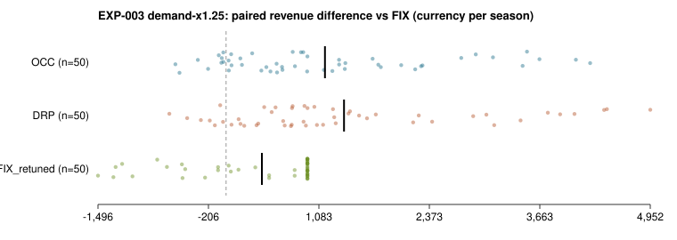

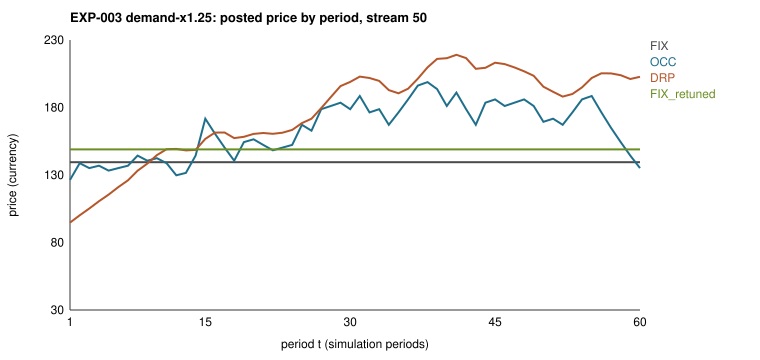

## Cell demand-x1.6 (index 4)

Timing: stream generation 0.05 s; tuning 1800 runs in 0.10 s; evaluation 200 runs in 0.05 s.

### Tuning

| Arm | Tuned in cell | Configs x streams | Selected | Mean tuning revenue | At grid edge | Purchase elasticity at selected FIX price |
|---|---|---|---|---|---|---|
| FIX | base-tuning | 36 x 50 | FIX(p=139.6) | 11,892.00 | no | -1.557 |
| OCC | base-tuning | 36 x 50 | OCC(p0=126.5, k=4) | 12,397.45 | yes | n/a |
| DRP | base-tuning | 36 x 50 | DRP(p0=94.85, eta=0.1, weight=0.3) | 12,501.49 | yes | n/a |
| FIX_retuned | demand-x1.6 | 36 x 50 | FIX(p=170.1) | 15,718.00 | no | -1.885 |

### Arms (per-stream metrics)

| Arm | Policy | n | revenue mean (sd) | sell_through mean (sd) | availability mean (sd) | price_volatility mean (sd) | consumer_surplus mean (sd) | stockout_period mean (sd) |
|---|---|---|---|---|---|---|---|---|
| FIX | FIX(p=139.6) | 50 | 13,838.16 (453.61) | 0.99 (0.03) | 0.81 (0.13) | 0.00 (0.00) | 8,242.04 (1,167.51) | 45.28 (10.19) |
| OCC | OCC(p0=126.5, k=4) | 50 | 15,779.16 (1,736.72) | 1.00 (0.00) | 0.93 (0.04) | 0.05 (0.00) | 8,713.30 (1,032.10) | 54.24 (2.79) |
| DRP | DRP(p0=94.85, eta=0.1, weight=0.3) | 50 | 16,080.85 (1,968.46) | 1.00 (0.01) | 0.98 (0.02) | 0.03 (0.01) | 8,409.84 (1,022.62) | 58.54 (2.01) |
| FIX_retuned | FIX(p=170.1) | 50 | 15,524.12 (2,079.55) | 0.91 (0.12) | 0.95 (0.07) | 0.00 (0.00) | 8,321.17 (1,435.25) | 56.00 (5.78) |

### Paired contrasts

| Arm | vs | Metric | n | Mean paired diff | SD diff | d_z | Level | Bootstrap CI | t CI | Relative | Class |
|---|---|---|---|---|---|---|---|---|---|---|---|
| OCC | FIX | revenue | 50 | 1,941.001 | 1,566.095 | 1.239 | 0.95 | [1,520.588, 2,369.979] | [1,495.922, 2,386.081] | 14.03% | detectable_practically_relevant |
| DRP | FIX | revenue | 50 | 2,242.687 | 1,769.251 | 1.268 | 0.95 | [1,768.540, 2,727.625] | [1,739.871, 2,745.502] | 16.21% | detectable_practically_relevant |
| OCC | FIX_retuned | revenue | 50 | 255.042 | 1,037.001 | 0.246 | 0.95 | [-34.939, 535.924] | [-39.670, 549.754] | 1.64% | inconclusive |
| DRP | FIX_retuned | revenue | 50 | 556.727 | 1,016.247 | 0.548 | 0.95 | [273.849, 830.324] | [267.913, 845.541] | 3.59% | detectable_practically_relevant |
| OCC | FIX | sell_through | 50 | 0.008 | 0.033 | 0.246 | 0.95 | [0.001, 0.018] | [-0.001, 0.017] | 0.81% | n/a |
| OCC | FIX | availability | 50 | 0.120 | 0.105 | 1.144 | 0.95 | [0.092, 0.149] | [0.090, 0.150] | 14.89% | n/a |
| OCC | FIX | consumer_surplus | 50 | 471.258 | 937.306 | 0.503 | 0.95 | [221.529, 734.780] | [204.879, 737.638] | 5.72% | n/a |
| OCC | FIX | total_surplus | 50 | 2,412.260 | 2,199.782 | 1.097 | 0.95 | [1,825.190, 3,015.473] | [1,787.088, 3,037.431] | 10.92% | n/a |
| DRP | FIX | sell_through | 50 | 0.005 | 0.032 | 0.160 | 0.95 | [-0.002, 0.016] | [-0.004, 0.014] | 0.52% | n/a |
| DRP | FIX | availability | 50 | 0.169 | 0.133 | 1.266 | 0.95 | [0.133, 0.205] | [0.131, 0.207] | 20.91% | n/a |
| DRP | FIX | consumer_surplus | 50 | 167.793 | 943.930 | 0.178 | 0.95 | [-82.229, 433.469] | [-100.469, 436.055] | 2.04% | n/a |
| DRP | FIX | total_surplus | 50 | 2,410.479 | 2,357.835 | 1.022 | 0.95 | [1,777.018, 3,065.825] | [1,740.390, 3,080.569] | 10.92% | n/a |

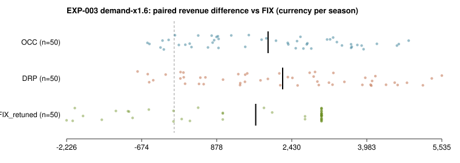

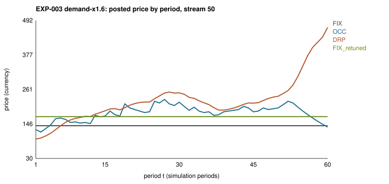

## Cell reversed-arrivals (index 5)

Timing: stream generation 0.05 s; tuning 1800 runs in 0.10 s; evaluation 200 runs in 0.04 s.

### Tuning

| Arm | Tuned in cell | Configs x streams | Selected | Mean tuning revenue | At grid edge | Purchase elasticity at selected FIX price |
|---|---|---|---|---|---|---|
| FIX | base-tuning | 36 x 50 | FIX(p=139.6) | 11,892.00 | no | -1.557 |
| OCC | base-tuning | 36 x 50 | OCC(p0=126.5, k=4) | 12,397.45 | yes | n/a |
| DRP | base-tuning | 36 x 50 | DRP(p0=94.85, eta=0.1, weight=0.3) | 12,501.49 | yes | n/a |
| FIX_retuned | reversed-arrivals | 36 x 50 | FIX(p=139.6) | 11,850.11 | no | -1.557 |

### Arms (per-stream metrics)

| Arm | Policy | n | revenue mean (sd) | sell_through mean (sd) | availability mean (sd) | price_volatility mean (sd) | consumer_surplus mean (sd) | stockout_period mean (sd) |
|---|---|---|---|---|---|---|---|---|
| FIX | FIX(p=139.6) | 50 | 11,341.93 (2,282.48) | 0.81 (0.16) | 0.95 (0.10) | 0.00 (0.00) | 7,538.32 (1,895.73) | 58.50 (5.29) |
| OCC | OCC(p0=126.5, k=4) | 50 | 11,970.07 (2,133.02) | 0.98 (0.03) | 0.98 (0.03) | 0.04 (0.00) | 8,919.70 (1,133.29) | 60.06 (1.49) |
| DRP | DRP(p0=94.85, eta=0.1, weight=0.3) | 50 | 11,141.62 (2,273.35) | 0.99 (0.01) | 0.97 (0.04) | 0.03 (0.01) | 9,631.13 (1,054.82) | 59.66 (1.49) |
| FIX_retuned | FIX(p=139.6) | 50 | 11,341.93 (2,282.48) | 0.81 (0.16) | 0.95 (0.10) | 0.00 (0.00) | 7,538.32 (1,895.73) | 58.50 (5.29) |

### Paired contrasts

| Arm | vs | Metric | n | Mean paired diff | SD diff | d_z | Level | Bootstrap CI | t CI | Relative | Class |
|---|---|---|---|---|---|---|---|---|---|---|---|
| OCC | FIX | revenue | 50 | 628.142 | 800.402 | 0.785 | 0.95 | [405.944, 846.832] | [400.670, 855.614] | 5.54% | detectable_practically_relevant |
| DRP | FIX | revenue | 50 | -200.308 | 924.896 | -0.217 | 0.95 | [-460.492, 54.543] | [-463.161, 62.545] | -1.77% | inconclusive |
| OCC | FIX_retuned | revenue | 50 | 628.142 | 800.402 | 0.785 | 0.95 | [405.944, 846.832] | [400.670, 855.614] | 5.54% | detectable_practically_relevant |
| DRP | FIX_retuned | revenue | 50 | -200.308 | 924.896 | -0.217 | 0.95 | [-460.492, 54.543] | [-463.161, 62.545] | -1.77% | inconclusive |
| OCC | FIX | sell_through | 50 | 0.164 | 0.143 | 1.141 | 0.95 | [0.125, 0.204] | [0.123, 0.204] | 20.14% | n/a |
| OCC | FIX | availability | 50 | 0.029 | 0.088 | 0.328 | 0.95 | [0.006, 0.054] | [0.004, 0.054] | 3.02% | n/a |
| OCC | FIX | consumer_surplus | 50 | 1,381.388 | 1,305.913 | 1.058 | 0.95 | [1,029.922, 1,742.859] | [1,010.251, 1,752.524] | 18.32% | n/a |
| OCC | FIX | total_surplus | 50 | 2,009.530 | 1,530.390 | 1.313 | 0.95 | [1,596.601, 2,434.476] | [1,574.598, 2,444.462] | 10.64% | n/a |
| DRP | FIX | sell_through | 50 | 0.180 | 0.166 | 1.082 | 0.95 | [0.135, 0.227] | [0.132, 0.227] | 22.11% | n/a |
| DRP | FIX | availability | 50 | 0.019 | 0.115 | 0.169 | 0.95 | [-0.010, 0.052] | [-0.013, 0.052] | 2.03% | n/a |
| DRP | FIX | consumer_surplus | 50 | 2,092.811 | 1,579.105 | 1.325 | 0.95 | [1,668.544, 2,531.943] | [1,644.034, 2,541.587] | 27.76% | n/a |
| DRP | FIX | total_surplus | 50 | 1,892.503 | 1,707.736 | 1.108 | 0.95 | [1,430.797, 2,374.424] | [1,407.169, 2,377.836] | 10.02% | n/a |

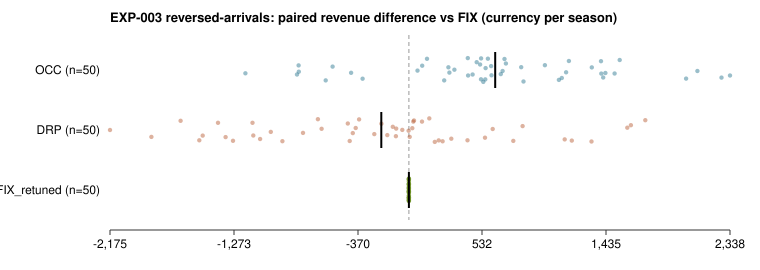

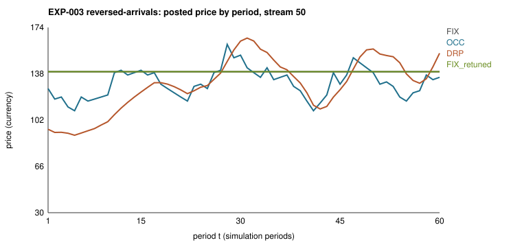

## Cell no-shocks (index 6)

Timing: stream generation 0.05 s; tuning 1800 runs in 0.10 s; evaluation 200 runs in 0.04 s.

### Tuning

| Arm | Tuned in cell | Configs x streams | Selected | Mean tuning revenue | At grid edge | Purchase elasticity at selected FIX price |
|---|---|---|---|---|---|---|
| FIX | base-tuning | 36 x 50 | FIX(p=139.6) | 11,892.00 | no | -1.557 |
| OCC | base-tuning | 36 x 50 | OCC(p0=126.5, k=4) | 12,397.45 | yes | n/a |
| DRP | base-tuning | 36 x 50 | DRP(p0=94.85, eta=0.1, weight=0.3) | 12,501.49 | yes | n/a |
| FIX_retuned | no-shocks | 36 x 50 | FIX(p=122.4) | 11,706.14 | no | -1.349 |

### Arms (per-stream metrics)

| Arm | Policy | n | revenue mean (sd) | sell_through mean (sd) | availability mean (sd) | price_volatility mean (sd) | consumer_surplus mean (sd) | stockout_period mean (sd) |
|---|---|---|---|---|---|---|---|---|
| FIX | FIX(p=139.6) | 50 | 11,464.79 (1,259.07) | 0.82 (0.09) | 1.00 (0.00) | 0.00 (0.00) | 7,662.31 (1,074.67) | 60.98 (0.14) |
| OCC | OCC(p0=126.5, k=4) | 50 | 11,851.74 (990.09) | 0.98 (0.02) | 0.99 (0.01) | 0.04 (0.00) | 9,120.47 (930.57) | 59.82 (1.35) |
| DRP | DRP(p0=94.85, eta=0.1, weight=0.3) | 50 | 11,959.52 (916.74) | 0.99 (0.01) | 0.99 (0.02) | 0.03 (0.00) | 8,812.86 (921.49) | 59.26 (1.65) |
| FIX_retuned | FIX(p=122.4) | 50 | 11,691.46 (847.72) | 0.96 (0.07) | 0.98 (0.03) | 0.00 (0.00) | 8,793.67 (920.97) | 58.70 (3.10) |

### Paired contrasts

| Arm | vs | Metric | n | Mean paired diff | SD diff | d_z | Level | Bootstrap CI | t CI | Relative | Class |
|---|---|---|---|---|---|---|---|---|---|---|---|
| OCC | FIX | revenue | 50 | 386.950 | 529.807 | 0.730 | 0.95 | [244.003, 534.818] | [236.380, 537.519] | 3.38% | detectable_practically_relevant |
| DRP | FIX | revenue | 50 | 494.730 | 656.412 | 0.754 | 0.95 | [319.758, 673.934] | [308.179, 681.280] | 4.32% | detectable_practically_relevant |
| OCC | FIX_retuned | revenue | 50 | 160.283 | 537.149 | 0.298 | 0.95 | [15.921, 309.726] | [7.627, 312.939] | 1.37% | detectable_practically_relevant |
| DRP | FIX_retuned | revenue | 50 | 268.063 | 533.615 | 0.502 | 0.95 | [121.810, 415.977] | [116.411, 419.715] | 2.29% | detectable_practically_relevant |
| OCC | FIX | sell_through | 50 | 0.163 | 0.078 | 2.083 | 0.95 | [0.141, 0.184] | [0.140, 0.185] | 19.80% | n/a |
| OCC | FIX | availability | 50 | -0.008 | 0.012 | -0.712 | 0.95 | [-0.012, -0.005] | [-0.012, -0.005] | -0.85% | n/a |
| OCC | FIX | consumer_surplus | 50 | 1,458.156 | 788.892 | 1.848 | 0.95 | [1,245.936, 1,670.606] | [1,233.956, 1,682.357] | 19.03% | n/a |
| OCC | FIX | total_surplus | 50 | 1,845.106 | 1,098.854 | 1.679 | 0.95 | [1,545.010, 2,142.354] | [1,532.815, 2,157.397] | 9.65% | n/a |
| DRP | FIX | sell_through | 50 | 0.171 | 0.090 | 1.905 | 0.95 | [0.147, 0.195] | [0.145, 0.196] | 20.80% | n/a |
| DRP | FIX | availability | 50 | -0.013 | 0.015 | -0.846 | 0.95 | [-0.017, -0.009] | [-0.017, -0.008] | -1.26% | n/a |
| DRP | FIX | consumer_surplus | 50 | 1,150.542 | 864.957 | 1.330 | 0.95 | [912.416, 1,387.758] | [904.724, 1,396.360] | 15.02% | n/a |
| DRP | FIX | total_surplus | 50 | 1,645.272 | 1,247.374 | 1.319 | 0.95 | [1,311.895, 1,984.842] | [1,290.772, 1,999.772] | 8.60% | n/a |

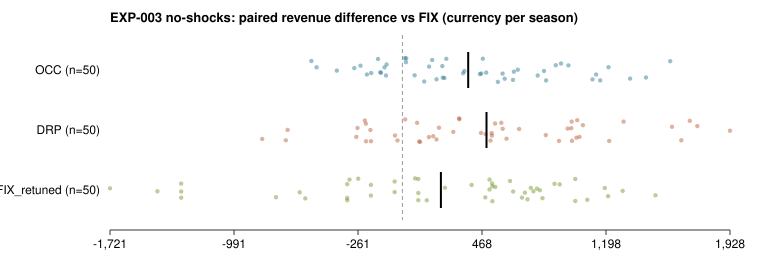

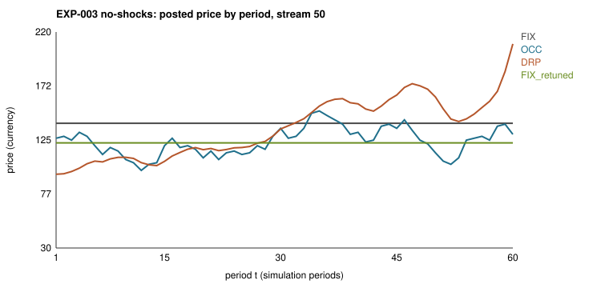

## Multiplicity across cells (revenue vs FIX, Holm over all listed contrasts)

| Cell | Arm | n | Mean paired revenue diff | Sign-flip p | Holm-adjusted p |
|---|---|---|---|---|---|
| demand-x0.6 | OCC | 50 | 64.106 | 0.5762 | 0.5762 |
| demand-x0.6 | DRP | 50 | -272.793 | 0.1030 | 0.3090 |
| demand-x0.8 | OCC | 50 | 261.062 | 0.0068 | 0.0340 |
| demand-x0.8 | DRP | 50 | 200.990 | 0.0426 | 0.1704 |
| demand-x1.25 | OCC | 50 | 1,153.997 | 0.0001 | 0.0012 |
| demand-x1.25 | DRP | 50 | 1,376.883 | 0.0001 | 0.0012 |
| demand-x1.6 | OCC | 50 | 1,941.001 | 0.0001 | 0.0012 |
| demand-x1.6 | DRP | 50 | 2,242.687 | 0.0001 | 0.0012 |
| reversed-arrivals | OCC | 50 | 628.142 | 0.0001 | 0.0012 |
| reversed-arrivals | DRP | 50 | -200.308 | 0.1328 | 0.3090 |
| no-shocks | OCC | 50 | 386.950 | 0.0001 | 0.0012 |
| no-shocks | DRP | 50 | 494.730 | 0.0001 | 0.0012 |
